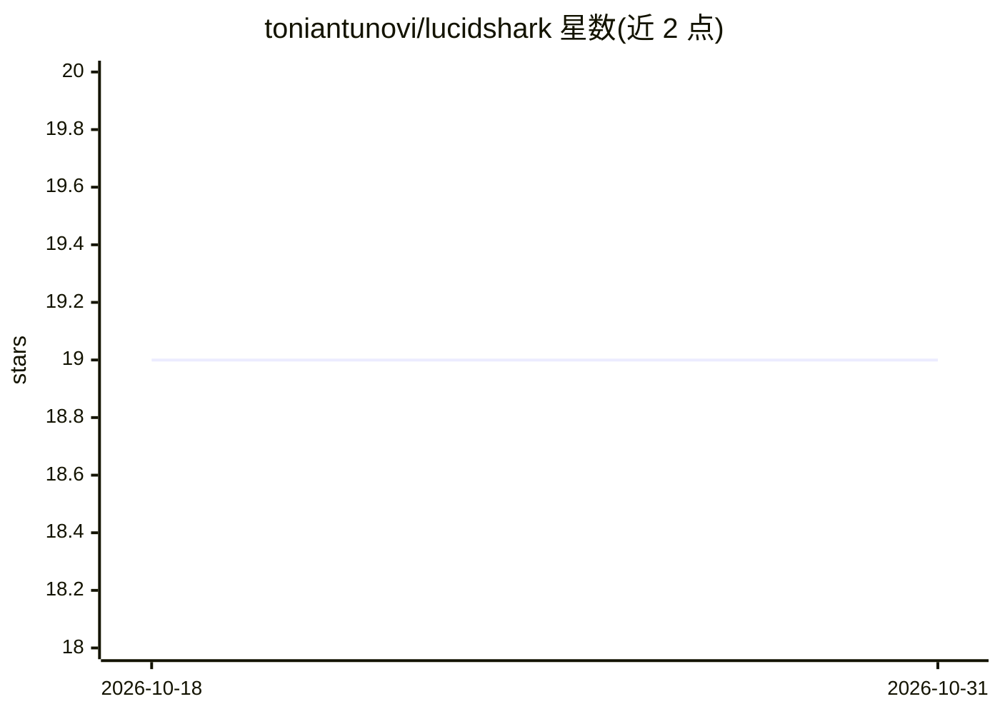

# toniantunovi/lucidshark

⭐ 19 · Python · Apache-2.0 · 推送 2026-10-24 · [GitHub](https://github.com/toniantunovi/lucidshark) · [官网](https://lucidshark.com) · 个人维护

**给 AI 辅助开发团队的本地一体化代码质量门禁工具**

面向 AI agent 写生产代码场景的统一质量检查管道：将 lint、类型检查、格式化、安全扫描（SAST/SCA/IaC/容器）、测试、覆盖率与重复检测聚合在一个 CLI 中，支持 14 种语言，结果归一化为统一格式。默认严格模式，缺失工具即报错；部分安全与检查工具可自动下载。默认增量扫描未提交变更。以独立二进制分发，通过 lucidshark.yml 做配置即代码，MCP 集成 Claude Code 使 agent 可直接消费结构化反馈，并生成 git 内提交的 QUALITY.md 质量看板。

## 筛选速览

| 维度 | 判定 | 备注 |
|---|---|---|
| AI 角色 | `ai-ecosystem` | LLM/agent 周边工具 |
| 许可风险 | `permissive` | Apache-2.0 |
| 部署形态 | `None` |  |
| 模型依赖 | locked-api |  |
| 硬件要求 | — | 无带数字的原话,不猜 |
| 安装摩擦 | `medium` | 含编译或系统依赖之一 |
| 成熟度 | — | 结构信号不足 |

## 能力要点

- 聚合 lint/类型/格式化/安全/测试/覆盖率/重复检测为单一 CLI，覆盖 14 种语言
- MCP 集成 Claude Code，输出 AI agent 可直接执行的结构化反馈
- 默认增量扫描未提交变更，严格模式下工具缺失即失败
- 生成 QUALITY.md 质量看板（健康分、趋势图），无需服务器或 SaaS

## 适用场景

- 让写代码的 AI agent 拿到结构化质量反馈自动修复问题
- 本地与 CI 使用同一套配置做统一质量门禁
- 跟踪仓库质量趋势并提交质量报告到 git

## 场景标签

 · 领域:开发者工具/代码质量

## 证据(README 行号)

> L9: AI writes code → LucidShark checks → AI fixes → repeat
> L22: - **AI-native** - MCP integration with Claude Code. Structured feedback that AI agents can act on directly.
> L24: - **Unified pipeline** - Linting, type checking, formatting, security (SAST/SCA/IaC), tests, coverage, and duplicat

## 星数曲线

2026-10-18 19 → 2026-10-31 19（+0）

---
*卡片 v1 · prompt 1.4 · 生成 2026-10-28 · 置信度 high · 依据 README sha `2e9aa876d00e` · [字段定义](../../DATASET.md)*
