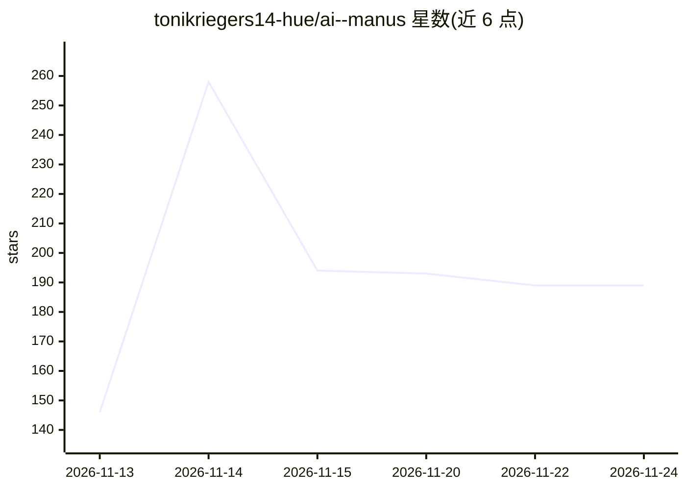

# tonikriegers14-hue/ai--manus

⭐ 189 · Apache-2.0 · 推送 2026-11-14 · [GitHub](https://github.com/tonikriegers14-hue/ai--manus) · 个人维护

**自主 AI Agent：代用户执行代码与控制浏览器完成任务**

自述为通用自主 AI Agent，在沙盒环境中运行各类工具与操作：自主编写并执行脚本、控制浏览器（打开网页、填表、采集信息）、执行多步骤任务，面向家庭、学习与轻量办公场景而非企业平台。README 描述了会话间保持一致的行为模式、代码与浏览器动作可在同一流程中衔接。给出最低双核 CPU/4GB 内存的兼容性表，但未提供具体安装命令、技术栈或模型接入细节，'Download Manus' 附带推广码，可信度存疑。

## 筛选速览

| 维度 | 判定 | 备注 |
|---|---|---|
| AI 角色 | `ai-native` | 本体是模型或模型工具 |
| 许可风险 | `permissive` | Apache-2.0 |
| 部署形态 | `None` |  |
| 模型依赖 | — | README 未给出锁定关系 |
| 硬件要求 | — | 无带数字的原话,不猜 |
| 安装摩擦 | `low` | 无编译、无系统依赖或容器化 |
| 成熟度 | — | 结构信号不足 |

## 能力要点

- 自主编写并执行代码脚本
- 浏览器控制：导航网页、填表、采集信息
- 代码与浏览器动作在同一工作流中衔接
- 面向小规模家庭/学习/轻办公任务

## 适用场景

- 让 agent 代为完成重复性的网页操作与脚本任务
- 学习研究中收集资料、运行小脚本
- 远程办公时从多个页面汇总信息

## 场景标签

`工作流自动化` `浏览器自动化` · 领域:效率与自动化

## 证据(README 行号)

> L10: - **Autonomous Code Execution:** Manus AI agent runs code on its own to complete tasks, so you can focus on decisio
> L18: Manus is an autonomous AI agent designed to run code and control a browser on your behalf. Instead of acting like a

## 星数曲线

2026-11-13 146 → 2026-11-24 189（+43）

---
*卡片 v1 · prompt 1.4 · 生成 2026-11-17 · 置信度 low · 依据 README sha `4347b4dd3fa7` · [字段定义](../../DATASET.md)*
