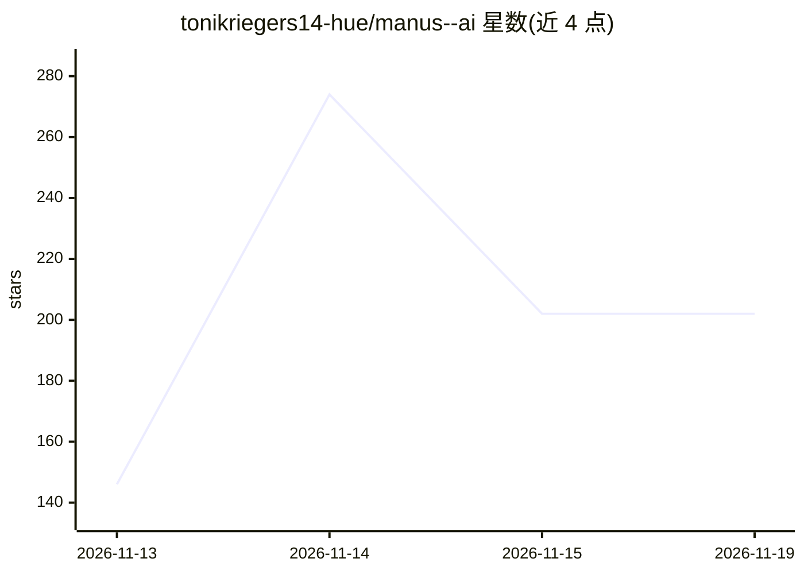

# tonikriegers14-hue/manus--ai

⭐ 202 · Apache-2.0 · 推送 2026-11-14 · [GitHub](https://github.com/tonikriegers14-hue/manus--ai) · 个人维护

**面向个人用户的自主 AI Agent：代跑代码与控制浏览器**

README 以营销式文案描述一个名为 Manus 的自主 AI Agent：可自行编写并执行脚本、控制浏览器完成导航/填表/采集，处理多步骤日常任务，定位为家庭、学习与轻量办公的个人助手，而非企业平台。文档给出最低 4 GB 内存的兼容性表格与上手步骤，但未提供任何安装命令、代码入口、依赖说明或模型接入细节，实际实现方式无法从 README 验证。

## 筛选速览

| 维度 | 判定 | 备注 |
|---|---|---|
| AI 角色 | `ai-native` | 本体是模型或模型工具 |
| 许可风险 | `permissive` | Apache-2.0 |
| 部署形态 | `None` |  |
| 模型依赖 | — | README 未给出锁定关系 |
| 硬件要求 | — | 无带数字的原话,不猜 |
| 安装摩擦 | `low` | 无编译、无系统依赖或容器化 |
| 成熟度 | — | 结构信号不足 |

## 能力要点

- 自主执行代码与浏览器控制（导航、填表、信息采集）
- 面向家庭、学习与轻量办公场景的个人后台助手
- 给出最低/推荐硬件兼容性表格（双核 CPU、4 GB 内存）

## 适用场景

- 让代理代替我跑小脚本和整理研究笔记
- 自动浏览多个网页收集信息并汇总
- 处理日常重复性小任务以减少手工操作

## 场景标签

`AI 助手` `编码 Agent` `浏览器自动化` · 领域:效率与自动化

## 证据(README 行号)

> L10: - **Autonomous Code Execution:** Manus AI agent runs code on its own to complete tasks, so you can focus on decisio
> L18: Manus is an autonomous AI agent designed to run code and control a browser on your behalf. Instead of acting like a

## 星数曲线

2026-11-13 146 → 2026-11-19 202（+56）

---
*卡片 v1 · prompt 1.4 · 生成 2026-11-17 · 置信度 low · 依据 README sha `885ad01e4b6b` · [字段定义](../../DATASET.md)*
