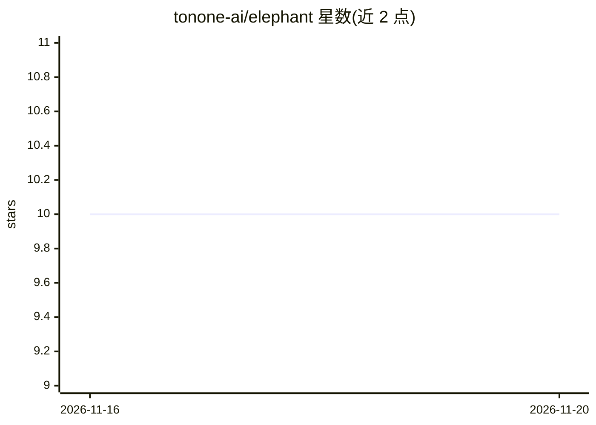

# tonone-ai/elephant

⭐ 10 · JavaScript · MIT · 推送 2026-10-14 · [GitHub](https://github.com/tonone-ai/elephant) · [官网](http://elephant.tonone.ai/) · 组织维护

**给 Claude Code 提供跨会话持久记忆的插件**

一个 Claude Code 插件，通过仓库根目录的 ELEPHANT.md 与全局 ~/.claude/elephant/memory.md 两个文件保存项目上下文，由 SessionStart 钩子在每次会话启动时注入记忆、Stop 钩子自动保存重要动作。附带 /elephant changelog 从 git log 生成 Keep a Changelog 格式的发布记录并建议 semver 版本号、/elephant readme 自动更新 README、/elephant takeover 读取最近 60 条提交冷启动种子记忆。采用 caveman 压缩控制 token 用量，记忆条目带作者署名并随仓库提交实现团队共享。

## 筛选速览

| 维度 | 判定 | 备注 |
|---|---|---|
| AI 角色 | `ai-ecosystem` | LLM/agent 周边工具 |
| 许可风险 | `permissive` | MIT |
| 部署形态 | `None` |  |
| 模型依赖 | locked-api |  |
| 硬件要求 | — | 无带数字的原话,不猜 |
| 安装摩擦 | `low` | 无编译、无系统依赖或容器化 |
| 成熟度 | — | 结构信号不足 |

## 能力要点

- 仓库级 ELEPHANT.md 与跨仓库全局记忆文件，随 git 提交实现团队共享
- SessionStart/Stop 钩子自动注入与保存记忆
- /elephant changelog 按 Keep a Changelog 分类并建议 semver 版本号
- caveman 压缩：一周历史约 150 tokens

## 适用场景

- 让 Claude Code 在新会话中记住技术栈、约定与进行中的工作
- 团队成员克隆仓库后自动获得相同项目上下文
- 从 git 提交自动生成 CHANGELOG.md 与 README 更新

## 场景标签

`Agent 记忆` `编码 Agent` · 领域:Agent 开发

## 证据(README 行号)

> L5:  Persistent memory + automated changelogs + auto-maintained READMEs for Claude Code.
> L93: A `SessionStart` hook injects your memory as context on every session. A `Stop` hook prompts Claude to save importa
> L65: claude plugin marketplace add tonone-ai/elephant

## 星数曲线

2026-11-16 10 → 2026-11-20 10（+0）

---
*卡片 v1 · prompt 1.4 · 生成 2026-11-19 · 置信度 high · 依据 README sha `612a63d1536e` · [字段定义](../../DATASET.md)*
