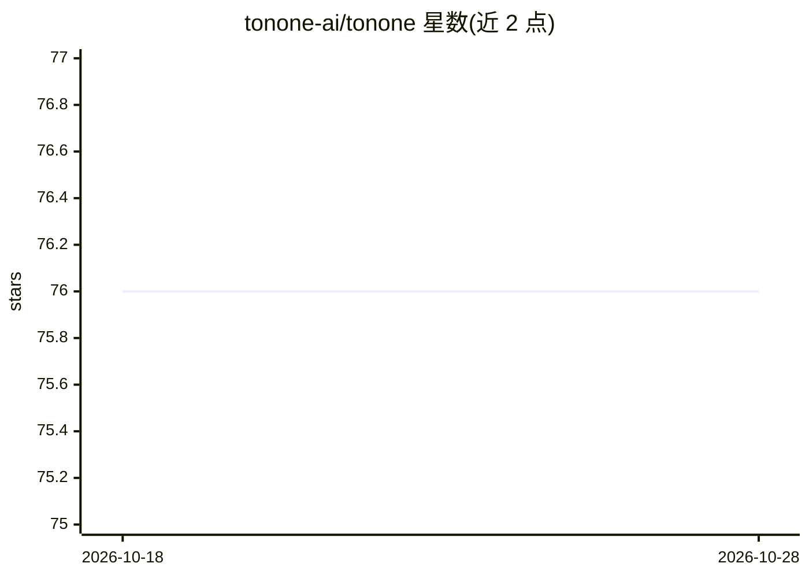

# tonone-ai/tonone

⭐ 76 · Python · MIT · 推送 2026-10-14 · [GitHub](https://github.com/tonone-ai/tonone) · [官网](https://second.tonone.ai) · 组织维护

**给 Claude Code 安装的 100 专家 agent 团队插件（10 团队 + 431 技能）**

面向独立创始人的 Claude Code 插件：安装后引入 100 个按领域划分的专家 agent（工程 15、产品 12、运营 4、法务 10、设计 10、数据科学 10、安全运营 10 等 10 个团队）和 431 个技能。工程主管 Apex 通过 /apex-plan 将需求切分为深度档位，展示各档使用的专家与 token/成本预算后执行；/apex-profile 可裁剪名单，/apex-takeover 对继承代码库做并行勘察。另有 Codex CLI 的 git clone 使用路径。MIT 许可。

## 筛选速览

| 维度 | 判定 | 备注 |
|---|---|---|
| AI 角色 | `ai-ecosystem` | LLM/agent 周边工具 |
| 许可风险 | `permissive` | MIT |
| 部署形态 | `self-host` | docker 或自建部署 |
| 模型依赖 | locked-api |  |
| 硬件要求 | — | 无带数字的原话,不猜 |
| 安装摩擦 | `low` | 无编译、无系统依赖或容器化 |
| 成熟度 | — | 结构信号不足 |

## 能力要点

- 100 个专家 agent 分 10 个团队，附 431 个技能
- /apex-plan 按深度档位（S/M/L/XL）报价并执行
- /apex-profile 可将名单裁剪为项目子集
- 支持 Codex CLI：克隆仓库后经 AGENTS.md 与 SKILL.md 调用

## 适用场景

- 独立创始人用一个插件覆盖工程/产品/法务/运营等职能
- 规划并分档执行构建任务并预览专家与成本
- 接手陌生代码库时做多专家并行勘察

## 场景标签

`多智能体` `编码 Agent` · 领域:Agent 开发

## 证据(README 行号)

> L5: 100 specialist agents in 10 teams for Claude Code, plus 431 skills. Tell the lead what you're building. It scopes th
> L20: Tonone is an open-source AI team you install into Claude Code. Not a generalist assistant — specialists. Each agent
> L26: **Prerequisites:** Claude Code v1.0+

## 星数曲线

2026-10-18 76 → 2026-10-28 76（+0）

---
*卡片 v1 · prompt 1.4 · 生成 2026-10-24 · 置信度 mid · 依据 README sha `914d85e4b493` · [字段定义](../../DATASET.md)*
