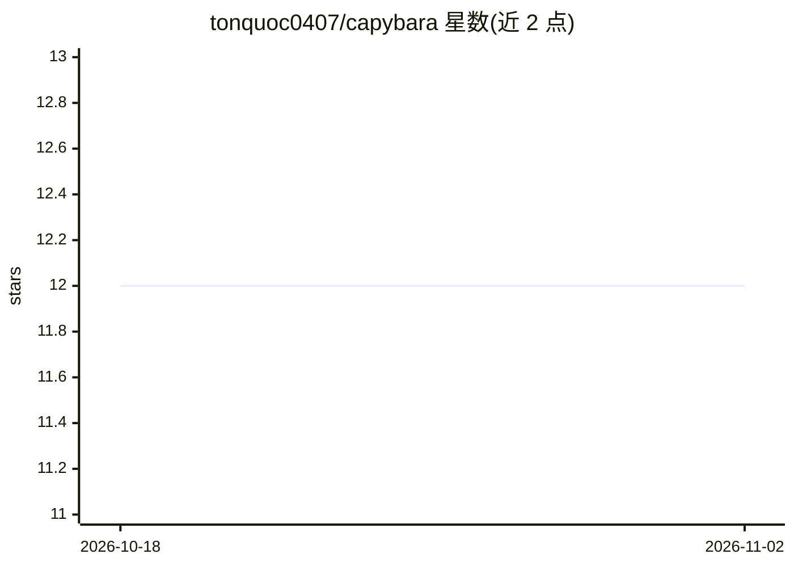

# tonquoc0407/capybara

⭐ 12 · Go · MIT · 推送 2026-10-25 · [GitHub](https://github.com/tonquoc0407/capybara) · 个人维护

**终端里的 AI agent 追踪调试器：记录并定位 agent 出错环节**

Go 编写的终端 TUI 工具，用于调试 AI agent：通过 OTLP 监听（4317/4318）、tail Claude Code 本地日志、导入 JSONL 追踪文件三种方式接收 span，写入本地 capybara.db。读取 OpenTelemetry gen_ai.*、OpenInference、OpenLLMetry、Vercel AI SDK legacy 四种属性约定。提供 span 树浏览、成本瀑布图、双 run diff、上下文视图、CPU/内存/GPU 资源监控，以及 19 类 findings（16 类确定性被动检测如 improvised/drift/tool_error/prompt_injection/secret_leak，3 类可选 LLM 判定）。发现默认只记录不拦截，仅 findings --fail-on 时以非零退出供 CI 使用。

## 筛选速览

| 维度 | 判定 | 备注 |
|---|---|---|
| AI 角色 | `ai-ecosystem` | LLM/agent 周边工具 |
| 许可风险 | `permissive` | MIT |
| 部署形态 | `desktop` | 安装包/桌面程序 |
| 模型依赖 | — | README 未给出锁定关系 |
| 硬件要求 | — | 无带数字的原话,不猜 |
| 安装摩擦 | `low` | 无编译、无系统依赖或容器化 |
| 成熟度 | — | 结构信号不足 |

## 能力要点

- 三种接入方式：OTLP 监听、tail Claude Code 日志、导入 JSONL/其他平台导出
- 读取 4 种追踪属性约定（gen_ai.*、OpenInference、OpenLLMetry、Vercel ai.*）
- 19 类 findings，含 improvised、drift、prompt_injection、secret_leak、orphaned_span 等
- 3 个可选 LLM judge（faithfulness/toolcheck/relevance），默认关闭且数据外发需自担

## 适用场景

- agent 上线失败后本地回放追踪，定位是哪一步出错
- 在 CI 中用 --fail-on 把 findings 转为非零退出
- 把 Langfuse/Phoenix/LangSmith/Weave 上的生产 run 拉到本地调试

## 场景标签

`LLM 可观测性` · 领域:评测与运维

## 证据(README 行号)

> L5:  A terminal trace debugger for AI agents.
> L27: Run it with no arguments. It opens the TUI, listens for OTLP on `127.0.0.1:4318` and `127.0.0.1:4317`, and tails `~
> L120: Findings are recorded, never enforced — analysis touches nothing outside the database, and only `findings --fail-o

## 星数曲线

2026-10-18 12 → 2026-11-02 12（+0）

---
*卡片 v1 · prompt 1.4 · 生成 2026-10-31 · 置信度 high · 依据 README sha `b5ee0c61b7d8` · [字段定义](../../DATASET.md)*
