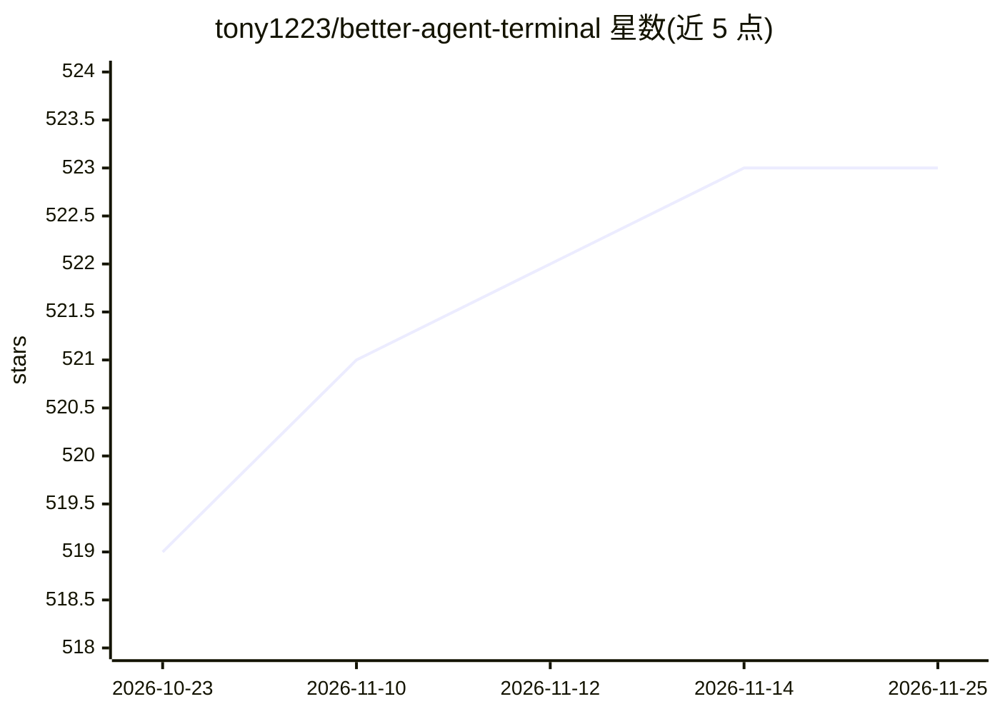

# tony1223/better-agent-terminal

⭐ 523 · Rust · MIT · 推送 2026-11-19 · [GitHub](https://github.com/tony1223/better-agent-terminal) · 个人维护 · 中文 README

**给开发者的多工作区终端聚合器，内置 Claude Code/Codex agent 面板**

基于 Tauri 的桌面终端聚合应用：在单窗口内按项目文件夹组织多个工作区与多个持久终端（xterm.js，支持 Unicode/CJK），并提供文件浏览器、Git 提交历史与 diff 查看、PR/Issue 面板、代码片段管理、Markdown 预览和 Procfile 多进程面板。AI 部分内置 Claude Code（SDK 运行，含权限模式、会话恢复/分叉、上下文自动压缩、费用与限流状态栏）与可选的 Codex Agent 后端，支持 git worktree 隔离运行 agent。3.0 起移除 Electron，改用 Rust/Tauri 宿主加 React 渲染层。

## 筛选速览

| 维度 | 判定 | 备注 |
|---|---|---|
| AI 角色 | `ai-enhanced` | 去掉 AI 部分产品仍成立 |
| 许可风险 | `permissive` | MIT |
| 部署形态 | `desktop` | 安装包/桌面程序 |
| 模型依赖 | locked-api |  |
| 硬件要求 | — | 无带数字的原话,不猜 |
| 安装摩擦 | `low` | 无编译、无系统依赖或容器化 |
| 成熟度 | — | 结构信号不足 |

## 能力要点

- 内置 Claude Code（SDK 方式），支持权限模式、会话恢复/分叉与自动压缩
- Codex Agent 可选后端，支持多模型切换与沙箱/审批策略
- agent 可在隔离 git worktree 中运行，避免改动主工作树
- 状态栏显示 token、费用、缓存与 5h/7d API 限流用量

## 适用场景

- 在一个窗口里管理多个项目的终端、文件与 Git
- 在终端应用内直接运行 Claude Code 处理编码任务
- 用隔离 worktree 让 agent 安全地执行改动
- 监控 agent 会话的 token 消耗与 API 限流额度

## 场景标签

`编码 Agent` · 领域:编码与开发

## 证据(README 行号)

> L10: **A Tauri-powered terminal aggregator with multi-workspace support and built-in AI agent integration**
> L12: Manage multiple project terminals in one window, with built-in Claude Code and Codex agent panels, file browser, gi
> L72: - **Built-in Claude Code** via SDK — Runs the agent directly inside the app; no separate terminal needed

## 星数曲线

2026-10-23 519 → 2026-11-25 523（+4）

---
*卡片 v1 · prompt 1.4 · 生成 2026-11-25 · 置信度 mid · 依据 README sha `a980671aec90` · [字段定义](../../DATASET.md)*
