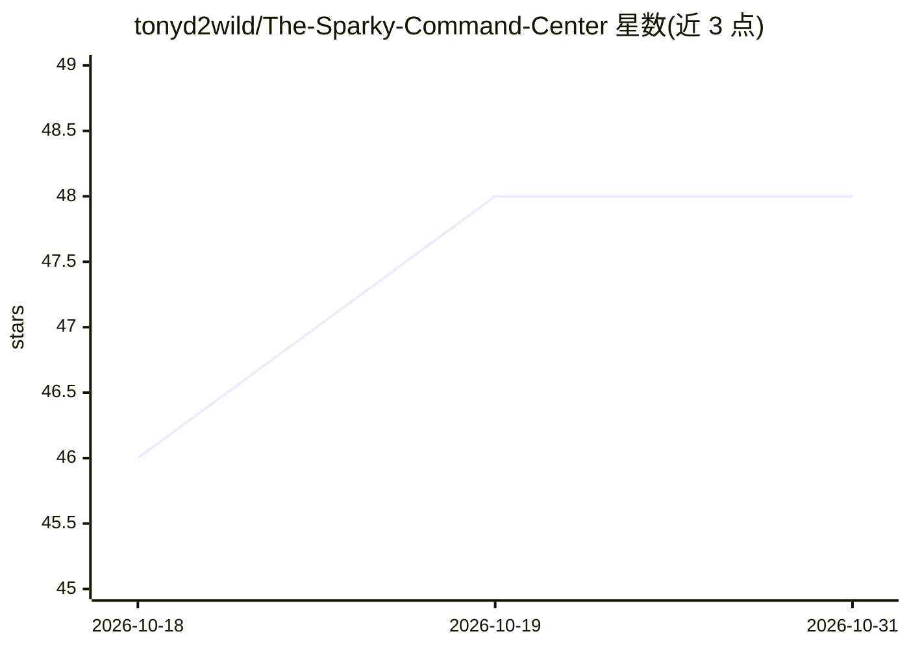

# tonyd2wild/The-Sparky-Command-Center

⭐ 48 · TypeScript · MIT · 推送 2026-10-13 · [GitHub](https://github.com/tonyd2wild/The-Sparky-Command-Center) · 个人维护

**自托管 GPU/AI 集群只读监控看板，带可接自有模型的聊天助手**

零依赖（Python 3.9+ 标准库）的 Web 监控面板：通过 SSH 读取 GPU 节点的温度/功耗/利用率/显存（DGX Spark、GB10 统一内存机型及 RTX/A 系列独显主机），经 Prometheus /metrics 读取 vLLM/SGLang/llama.cpp 模型服务的 decode/prefill tok/s、TTFT、KV-cache 用量，另支持 MikroTik RouterOS 交换机、ComfyUI 渲染通道与跨重启的 token 计数。内置聊天助手 speaks OpenAI 兼容协议，可将实时看板数据作为上下文注入，接入任意本地模型或 agent。默认只读，节点侧仅需 nvidia-smi 与密钥 SSH。

## 筛选速览

| 维度 | 判定 | 备注 |
|---|---|---|
| AI 角色 | `ai-ecosystem` | LLM/agent 周边工具 |
| 许可风险 | `permissive` | MIT |
| 部署形态 | `library` | 以包/库形式分发 |
| 模型依赖 | local-ok | 支持本地模型 |
| 硬件要求 | — | 无带数字的原话,不猜 |
| 安装摩擦 | `low` | 无编译、无系统依赖或容器化 |
| 成熟度 | — | 结构信号不足 |

## 能力要点

- SSH 读取 GPU 节点温度/功耗/利用率/容器，节点侧零安装
- 经 Prometheus /metrics 展示 vLLM/SGLang/llama.cpp 的 tok/s、TTFT、KV-cache
- 聊天助手兼容 OpenAI 协议，可指向任意本地模型或 agent，并以实时数据作为 grounding
- 跨服务重启的 per-model token 计数与每日统计

## 适用场景

- 家庭实验室/小机队实时查看各 GPU 节点与模型服务状态
- 通过对话询问'哪个节点最热''什么挂了'并获得基于实时数据的回答
- 追踪每个模型累计服务的 token 数量

## 场景标签

`LLM 可观测性` · 领域:评测与运维

## 证据(README 行号)

> L3: A read-only command center for a self-hosted AI fleet, with a live Three.js constellation of your machines and a bui
> L9: - **Model servers** (vLLM, SGLang, llama.cpp) through their Prometheus `/metrics`: decode and prefill tok/s, TTFT, K
> L82: - **Grounded.** Every turn gets a system message with a compact read of the live board, taken at the moment you ask

## 星数曲线

2026-10-18 46 → 2026-10-31 48（+2）

---
*卡片 v1 · prompt 1.4 · 生成 2026-10-25 · 置信度 mid · 依据 README sha `636ec7360515` · [字段定义](../../DATASET.md)*
