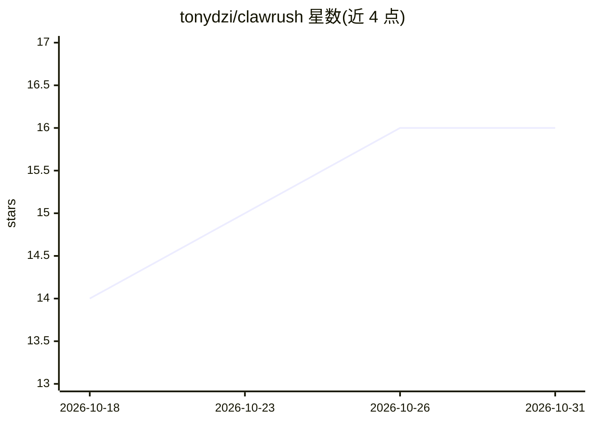

# tonydzi/clawrush

⭐ 16 · Python · MIT · 推送 2026-10-30 · [GitHub](https://github.com/tonydzi/clawrush) · 个人维护

**个人 AI「第二大脑」构建过程的公开日记与可复用产物仓库**

记录用 Claude Code 构建个人 AI 数字孪生/第二大脑（C(H+A)RM，人机协作 CRM，框架在 charm-os 仓库）的公开构建日记。内容按目录组织：/devlog 构建日志、/longreads 英俄双语长文、/artifacts 可复用技能模式与脚本、/diary 社交帖索引及 changelog。提供 llms.txt 供 agent 读取，并关联同一实验室的多层仓库体系（治理/记忆/门控/机群等）。仓库本体不含可运行代码，附带的技能包 second-brain-starter-kit（101 个技能）经 npx 单独安装。

## 筛选速览

| 维度 | 判定 | 备注 |
|---|---|---|
| AI 角色 | `ai-knowledge` | 知识聚合/清单类 |
| 许可风险 | `permissive` | MIT |
| 部署形态 | `library` | 以包/库形式分发 |
| 模型依赖 | — | README 未给出锁定关系 |
| 硬件要求 | — | 无带数字的原话,不猜 |
| 安装摩擦 | `low` | 无编译、无系统依赖或容器化 |
| 成熟度 | — | 结构信号不足 |

## 能力要点

- 按目录组织的英文/俄文构建日记与长文
- /artifacts 提供可复用技能模式、提示词与脚本
- llms.txt 机器可读站点地图，robots.txt 欢迎 AI 爬虫
- 关联同实验室治理/记忆/门控/机群等多层仓库体系

## 适用场景

- 追踪一个人机协作 CRM/第二大脑系统的构建过程
- 提取可复用的 Claude Code 技能模式与提示词
- 了解 build-in-public 方式运营 AI agent 实验室的记录结构

## 场景标签

`提示工程` · 领域:Agent 开发

## 证据(README 行号)

> L13: - **`/devlog`** — the raw build log: problems → root causes → fixes, plus the Deep Research we ran. Dry, English, m
> L16: - **`/artifacts`** — reusable pieces: skill patterns, prompts, small scripts, design notes — meant to be lifted and

## 星数曲线

2026-10-18 14 → 2026-10-31 16（+2）

---
*卡片 v1 · prompt 1.4 · 生成 2026-10-30 · 置信度 mid · 依据 README sha `389c6d3ee4a7` · [字段定义](../../DATASET.md)*
