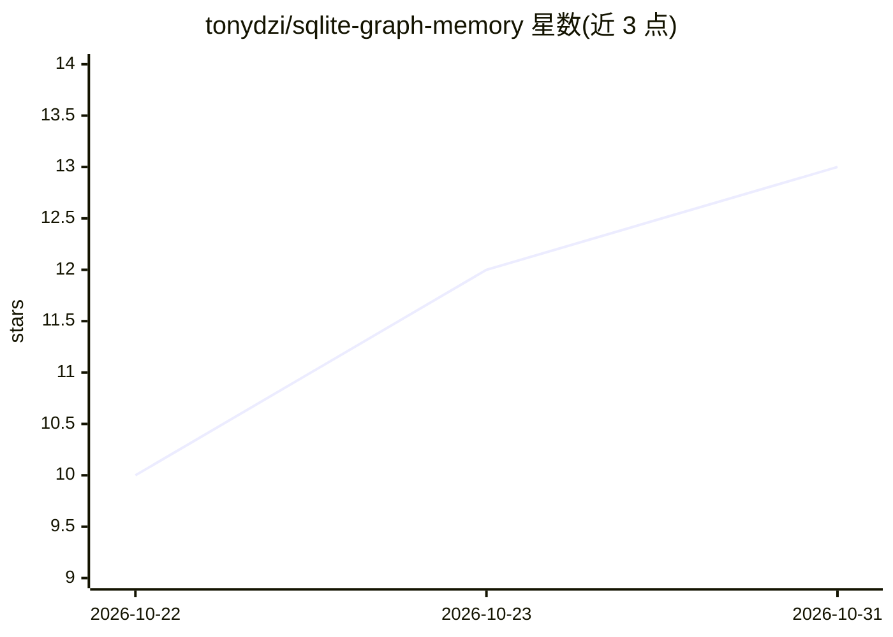

# tonydzi/sqlite-graph-memory

⭐ 13 · Python · MIT · 推送 2026-10-28 · [GitHub](https://github.com/tonydzi/sqlite-graph-memory) · 个人维护

**面向编码 Agent 的持久记忆层：MCP 服务器 + SQLite 上的 Graph RAG**

为 Claude Code、Cursor、Codex 等 MCP 客户端提供长期记忆：以 pip 安装的 MCP 服务器加 CLI，索引任意 markdown 笔记文件夹（含 Obsidian vault），向量检索找入口、手写的 [[wikilink]] 构成图、交叉编码器重排，SQLite 为唯一存储，无需图数据库与实体抽取。提供 --ab 双管线对照测量、公开基准 bench/、无标注评测 eval/（以 wikilink 为相关性标签）。自述为 pilot：无增量索引、测试覆盖不均，生产环境为单一约 2.8 万笔记的个人 setup。给开发者和重度笔记用户使用。

## 筛选速览

| 维度 | 判定 | 备注 |
|---|---|---|
| AI 角色 | `ai-ecosystem` | LLM/agent 周边工具 |
| 许可风险 | `permissive` | MIT |
| 部署形态 | `library` | 以包/库形式分发 |
| 模型依赖 | — | README 未给出锁定关系 |
| 硬件要求 | — | 无带数字的原话,不猜 |
| 安装摩擦 | `medium` | 含编译或系统依赖之一 |
| 成熟度 | `idea` | |

## 能力要点

- 向量检索 + wikilink 一跳图扩展 + 交叉编码器重排，SQLite 单文件存储
- MCP 服务器（sgm-mcp）接入 Claude Code、Cursor、Codex、Zed、Windsurf 等
- --ab 在每条真实查询上对照 vector-only 与 graph 模式并记录到 ab_recall 表
- 公开可复现基准 bench/（202 笔记合成 vault、91 题、CI 重算）与 eval/ 无 LLM 评测

## 适用场景

- 让 Claude Code/Cursor/Codex 在会话间记住我 Obsidian 笔记里的内容
- 在自有 markdown 知识库上做带图关联的检索问答
- 测量 graph 模式相对纯向量检索在自己的笔记上是否有效

## 场景标签

`Agent 记忆` `RAG` · 领域:Agent 开发

## 证据(README 行号)

> L5: Long-term memory for coding agents that lives in the notes you already keep: an MCP server
> L51: **From any MCP client** (Claude Desktop, Cursor, Zed, Windsurf): `sgm-mcp` after the install
> L61: Graph RAG on SQLite for AI agents — a working pilot, not a framework. It is the extracted

## 星数曲线

2026-10-22 10 → 2026-10-31 13（+3）

---
*卡片 v1 · prompt 1.4 · 生成 2026-10-31 · 置信度 high · 依据 README sha `790ad2f5fa3a` · [字段定义](../../DATASET.md)*
