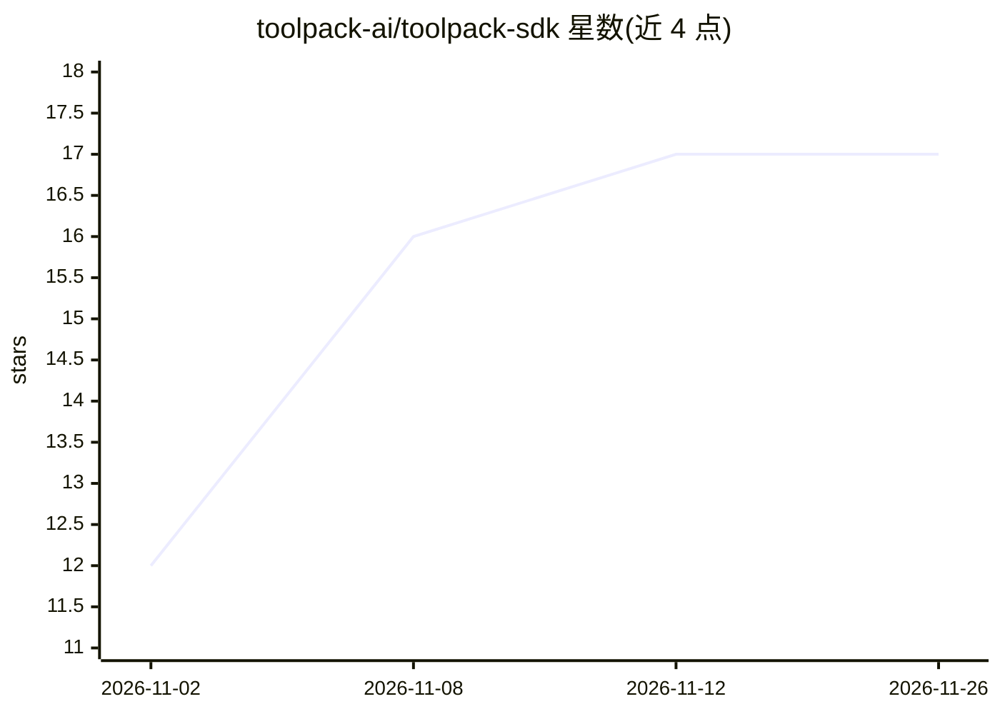

# toolpack-ai/toolpack-sdk

⭐ 17 · TypeScript · Apache-2.0 · 推送 2026-11-15 · [GitHub](https://github.com/toolpack-ai/toolpack-sdk) · [官网](https://toolpacksdk.com/) · 组织维护

**TypeScript 统一 SDK：一个 API 接多家 AI 提供商构建 agent**

面向 TypeScript/Node.js 开发者的 AI 应用构建 SDK。提供统一接口接入 OpenAI、Anthropic、Gemini、Ollama、OpenRouter 及自定义提供商（扩展 ProviderAdapter），支持流式输出、多模态输入、向量生成与 MCP 双向集成（客户端/服务端）。内置 100+ 工具（文件、代码、Git、数据库、HTTP、GitHub、Kubernetes 等 12+ 类）、Agent/Coding/Chat 三种模式与 createMode 自定义、带规划与并行工具编排的工作流引擎、HITL 确认机制。要求 Node.js >= 20；Kubernetes 工具需 kubectl 已安装配置。

## 筛选速览

| 维度 | 判定 | 备注 |
|---|---|---|
| AI 角色 | `ai-ecosystem` | LLM/agent 周边工具 |
| 许可风险 | `permissive` | Apache-2.0 |
| 部署形态 | `library` | 以包/库形式分发 |
| 模型依赖 | local-ok | 支持本地模型 |
| 硬件要求 | — | 无带数字的原话,不猜 |
| 安装摩擦 | `low` | 无编译、无系统依赖或容器化 |
| 成熟度 | — | 结构信号不足 |

## 能力要点

- 统一 API 接入 5 家内置提供商并可扩展 ProviderAdapter
- 100+ 内置工具覆盖文件/代码/Git/数据库/HTTP/GitHub/K8s 等类别
- MCP 双向支持：消费外部 MCP 服务器，也可作为 MCP server 暴露工具
- 工作流引擎：AI 规划 + 单次调用内并行工具编排
- 模式系统与 HITL 人工确认、自定义工具/通道/拦截器插件点

## 适用场景

- 在 TypeScript 项目中构建跨多家 AI 提供商的 agent 应用
- 让 agent 执行文件、代码、Git、数据库、Kubernetes 等操作
- 通过 MCP server 模式把工具暴露给 Claude Desktop / Cursor 等客户端
- 为高风险操作配置 human-in-the-loop 审批

## 场景标签

`Agent 框架` `模型网关` · 领域:Agent 开发

## 证据(README 行号)

> L12: - **Unified API** — Single interface for OpenAI, Anthropic, Google Gemini, Ollama, OpenRouter, and custom providers
> L3: The TypeScript SDK for building production AI agents — 100+ built-in tools, 9 channel integrations, a persistent cog

## 星数曲线

2026-11-02 12 → 2026-11-26 17（+5）

---
*卡片 v1 · prompt 1.4 · 生成 2026-11-18 · 置信度 high · 依据 README sha `f998abf1295c` · [字段定义](../../DATASET.md)*
