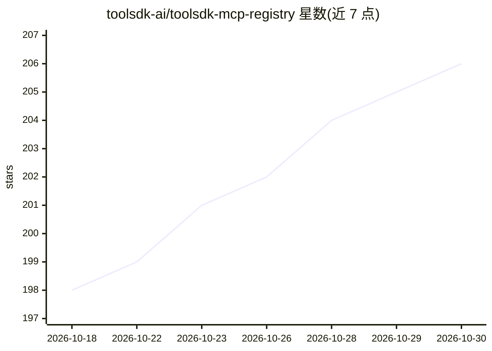

# toolsdk-ai/toolsdk-mcp-registry

⭐ 206 · TypeScript · MIT · 推送 2026-10-25 · [GitHub](https://github.com/toolsdk-ai/toolsdk-mcp-registry) · [官网](https://toolsdk.ai) · 组织维护

**MCP 服务器注册表与网关：发现、接入并执行 MCP 工具**

面向 MCP 生态的注册表与网关平台：收录 5096 个 MCP 服务器的结构化 JSON 配置与工具元数据，提供联邦发现（含官方 MCP Registry）、统一网关（将本地 STDIO 与远程 Streamable HTTP 服务器桥接为标准 MCP 端点）、HTTP API、沙箱执行（Sandock/Daytona/E2B）与 OAuth 2.1 代理。可通过 Docker Compose 自托管（含 Meilisearch 与 OpenAPI 文档），也可通过托管 API、npm 包或公开 JSON 端点读取目录数据。开发者还可提交自己的 MCP 服务器并获取状态徽章。

## 筛选速览

| 维度 | 判定 | 备注 |
|---|---|---|
| AI 角色 | `ai-ecosystem` | LLM/agent 周边工具 |
| 许可风险 | `permissive` | MIT |
| 部署形态 | `self-host` | docker 或自建部署 |
| 模型依赖 | — | README 未给出锁定关系 |
| 硬件要求 | — | 无带数字的原话,不猜 |
| 安装摩擦 | `low` | 无编译、无系统依赖或容器化 |
| 成熟度 | — | 结构信号不足 |

## 能力要点

- 5096 个 MCP 服务器的结构化 JSON 注册表与工具元数据
- 统一网关桥接 STDIO 与 Streamable HTTP 至 /mcp/<registry-key> 端点
- 沙箱执行（Sandock/Daytona/E2B）与 OAuth 2.1 代理
- Docker Compose 一键自托管，含 Meilisearch 搜索与 OpenAPI 文档

## 适用场景

- 为我的 AI 应用查找并接入 MCP 工具
- 自部署 MCP 网关统一管理本地与远程 MCP 服务器
- 通过 HTTP API 或 npm 包读取注册表数据构建目录服务
- 发布自己的 MCP 服务器并展示注册状态徽章

## 场景标签

`精选清单` · 领域:学习与行业

## 证据(README 行号)

> L7: Discover MCP servers. Connect AI applications. Execute tools through one gateway.
> L26:  ToolSDK connects AI clients with MCP servers through its registry and hosting platform
> L147: - **Structured Registry** - 5096 MCP servers organized by category, with reusable JSON configurations and tool met

## 星数曲线

2026-10-18 198 → 2026-10-30 206（+8）

---
*卡片 v1 · prompt 1.4 · 生成 2026-10-22 · 置信度 mid · 依据 README sha `022d172d7ed2` · [字段定义](../../DATASET.md)*
