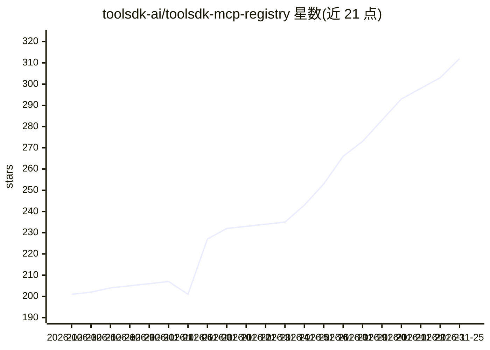

# toolsdk-ai/toolsdk-mcp-registry

⭐ 312 · TypeScript · MIT · 推送 2026-11-23 · [GitHub](https://github.com/toolsdk-ai/toolsdk-mcp-registry) · [官网](https://toolsdk.ai) · 组织维护

**MCP 服务器注册表与网关：发现、连接并执行工具**

提供 MCP 服务器的结构化 JSON 注册表（收录 5948 个服务器，按类别组织）与可自部署的 MCP 网关：通过 Docker Compose 部署后，可经 HTTP API 检查服务器、发现工具并执行调用；网关将本地 STDIO 包与远程 Streamable HTTP 服务器桥接为统一的 /mcp/<key> 端点供 MCP 客户端连接。支持 OAuth 2.1 代理、沙箱隔离执行（Sandock/Daytona/E2B）、联邦发现（本地条目与官方 MCP Registry）、Meilisearch 检索与 OpenAPI 文档。提供托管 API、npm 包与 GitHub Pages JSON 索引。

## 筛选速览

| 维度 | 判定 | 备注 |
|---|---|---|
| AI 角色 | `ai-ecosystem` | LLM/agent 周边工具 |
| 许可风险 | `permissive` | MIT |
| 部署形态 | `self-host` | docker 或自建部署 |
| 模型依赖 | — | README 未给出锁定关系 |
| 硬件要求 | — | 无带数字的原话,不猜 |
| 安装摩擦 | `low` | 无编译、无系统依赖或容器化 |
| 成熟度 | — | 结构信号不足 |

## 能力要点

- 收录 5948 个 MCP 服务器的结构化 JSON 配置与工具元数据
- 自部署 MCP 网关：统一桥接 STDIO 与 Streamable HTTP 工具
- OAuth 2.1 代理与沙箱隔离执行（Sandock/Daytona/E2B）
- 发布 JSON 索引与 npm 包，供构建目录与集成

## 适用场景

- 为 AI 应用查找并接入 MCP 服务器工具
- 自托管一个私有 MCP 网关与注册表
- 向社区目录提交自己的 MCP 服务器

## 场景标签

`精选清单` · 领域:学习与行业

## 证据(README 行号)

> L7: Discover MCP servers. Connect AI applications. Execute tools through one gateway.
> L43: Deploy your own **MCP Gateway & Registry** with Docker Compose:
> L148: - **Structured Registry** - 5948 MCP servers organized by category, with reusable JSON configurations and tool met
> L150: - **Unified Gateway** - Access local STDIO and remote Streamable HTTP tools through an HTTP API or a standard MCP 

## 星数曲线

2026-10-23 201 → 2026-11-25 312（+111）

---
*卡片 v1 · prompt 1.4 · 生成 2026-11-25 · 置信度 mid · 依据 README sha `22edfa99b7c0` · [字段定义](../../DATASET.md)*
