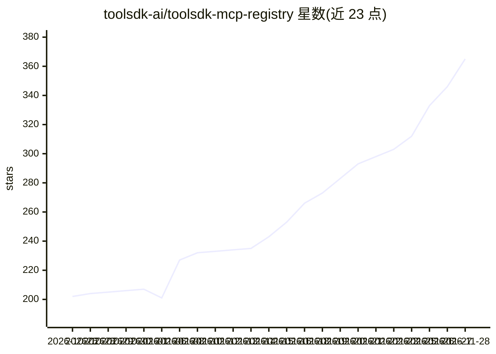

# toolsdk-ai/toolsdk-mcp-registry

⭐ 365 · TypeScript · MIT · 推送 2026-11-27 · [GitHub](https://github.com/toolsdk-ai/toolsdk-mcp-registry) · [官网](https://toolsdk.ai) · 组织维护

**MCP 服务器注册表与网关：供 AI 应用发现并调用工具**

自托管的 MCP 服务器注册表与网关项目：收录 6063 个 MCP 服务器的结构化 JSON 配置与工具元数据，提供 Docker Compose 一键部署的 Gateway，将本地 STDIO 与远程 Streamable HTTP 服务器统一桥接为 /mcp/<key> 端点，供 VS Code 等 MCP 客户端连接。附带 HTTP API、OpenAPI 文档、Meilisearch 搜索、OAuth 2.1 代理，以及可通过 Sandock/Daytona/E2B 沙箱隔离执行工具。注册表索引以 GitHub Pages JSON 与 npm 包形式发布，含 Vercel AI SDK 适配示例。社区通过 JSON PR 提交服务器条目。

## 筛选速览

| 维度 | 判定 | 备注 |
|---|---|---|
| AI 角色 | `ai-ecosystem` | LLM/agent 周边工具 |
| 许可风险 | `permissive` | MIT |
| 部署形态 | `self-host` | docker 或自建部署 |
| 模型依赖 | — | README 未给出锁定关系 |
| 硬件要求 | — | 无带数字的原话,不猜 |
| 安装摩擦 | `low` | 无编译、无系统依赖或容器化 |
| 成熟度 | — | 结构信号不足 |

## 能力要点

- 6063 个 MCP 服务器的结构化 JSON 注册表，按类别组织
- 统一网关桥接 STDIO 与 Streamable HTTP，供 MCP 客户端接入
- Docker Compose 自托管部署，含 Meilisearch 与 OpenAPI 文档
- OAuth 2.1 代理与沙箱隔离执行（Sandock/Daytona/E2B）

## 适用场景

- 为 AI 应用查找并集成经过验证的 MCP 工具
- 自托管私有 MCP 网关统一管理内外部服务器
- 基于注册表 JSON 构建自己的 MCP 目录与发现服务
- 把自己的 MCP 服务器提交到公共目录供他人发现

## 场景标签

`精选清单` · 领域:学习与行业

## 证据(README 行号)

> L5: **The Enterprise MCP Registry & Gateway.**
> L148: - **Structured Registry** - 6063 MCP servers organized by category, with reusable JSON configurations and tool met
> L150: - **Unified Gateway** - Access local STDIO and remote Streamable HTTP tools through an HTTP API or a standard MCP 

## 星数曲线

2026-10-26 202 → 2026-11-28 365（+163）

---
*卡片 v1 · prompt 1.4 · 生成 2026-11-28 · 置信度 mid · 依据 README sha `0f935ee9e902` · [字段定义](../../DATASET.md)*
