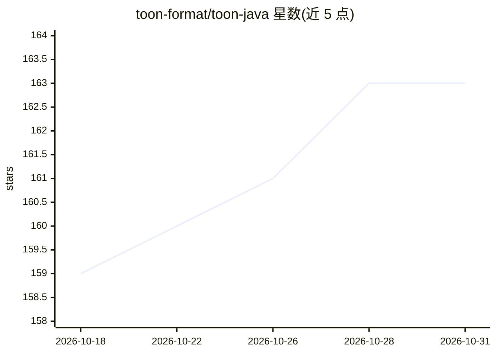

# toon-format/toon-java

⭐ 163 · Java · MIT · 推送 2026-10-29 · [GitHub](https://github.com/toon-format/toon-java) · 组织维护

**TOON 序列化格式的 Java 编解码库，压缩 LLM 上下文 token**

社区驱动的 TOON 格式 Java 实现：将 Java 对象或 JSON 字符串编码为 TOON 格式，声称相对 JSON 可减少 30-60% token；也支持将 TOON 解码回 Java 对象或 JSON。采用 YAML 风格缩进与 CSV 风格表格数组，支持逗号/制表符/竖线三种分隔符、数组长度校验、Jackson 注解、NullAway+JSpecify 空安全。主分支面向 Java 21，另有维护至 2027 Q4 的 Java 17 分支，声明 100% 符合 TOON 规范 4.4，通过 Maven Central 分发。

## 筛选速览

| 维度 | 判定 | 备注 |
|---|---|---|
| AI 角色 | `ai-ecosystem` | LLM/agent 周边工具 |
| 许可风险 | `permissive` | MIT |
| 部署形态 | `desktop` | 安装包/桌面程序 |
| 模型依赖 | — | README 未给出锁定关系 |
| 硬件要求 | — | 无带数字的原话,不猜 |
| 安装摩擦 | `medium` | 含编译或系统依赖之一 |
| 成熟度 | — | 结构信号不足 |

## 能力要点

- Java 对象/JSON 与 TOON 格式的双向转换（encode/decode）
- 逗号/制表符/竖线三种数组分隔符，制表符可进一步降低 token 数
- 支持 Jackson 注解（如 @JsonIgnore）与严格/宽松两种校验模式
- Java 21 主线与 Java 17 维护分支（2.0.x，至 2027 Q4）

## 适用场景

- Java 应用在与 LLM 交互时压缩 JSON 载荷的 token 用量
- 将结构化数据序列化为 LLM 友好的紧凑文本格式
- TOON 格式数据的解析与回转为 JSON

## 场景标签

 · 领域:LLM 基础设施/数据序列化

## 证据(README 行号)

> L10: Compact, human-readable serialization format for LLM contexts with **30-60% token reduction** vs JSON. Combines YAM
> L12: **Key Features:** Minimal syntax • TOON Encoding and Decoding • Tabular arrays for uniform data • Array length vali

## 星数曲线

2026-10-18 159 → 2026-10-31 163（+4）

---
*卡片 v1 · prompt 1.4 · 生成 2026-10-22 · 置信度 high · 依据 README sha `4ca52d8a0aa4` · [字段定义](../../DATASET.md)*
