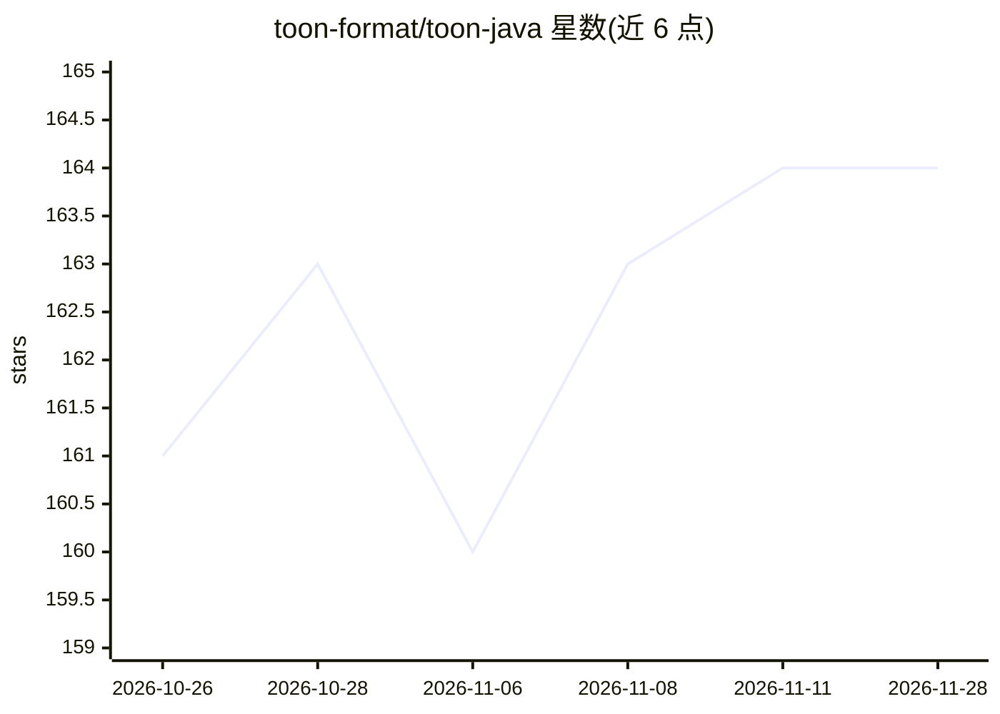

# toon-format/toon-java

⭐ 164 · Java · MIT · 推送 2026-11-21 · [GitHub](https://github.com/toon-format/toon-java) · 组织维护

**面向 Java 开发者的 TOON 格式编码解码库，压缩 LLM 上下文 token**

TOON 序列化格式的社区 Java 实现：提供 encode/decode 双向 API，将 Java 对象或 JSON 字符串转为缩进+表格数组风格的 TOON 文本并还原，声明相比 JSON 减少 30-60% token。支持 Jackson 注解、多种 Java 时间类型与 Optional/Stream 的规范化转换、可配置缩进/分隔符/键折叠/严格校验，含数组长度校验与解码上限保护。通过 Maven Central 发布，要求 Java 17（2.0.x）或 Java 21（3.0.0+），CI 强制符合 TOON spec 4.4.0。

## 筛选速览

| 维度 | 判定 | 备注 |
|---|---|---|
| AI 角色 | `ai-ecosystem` | LLM/agent 周边工具 |
| 许可风险 | `permissive` | MIT |
| 部署形态 | `desktop` | 安装包/桌面程序 |
| 模型依赖 | — | README 未给出锁定关系 |
| 硬件要求 | — | 无带数字的原话,不猜 |
| 安装摩擦 | `medium` | 含编译或系统依赖之一 |
| 成熟度 | — | 结构信号不足 |

## 能力要点

- encode/decode 双向 API，含 JSON 字符串与 TOON 互转
- 表格数组与键折叠选项，面向统一结构数据
- Jackson 注解支持与 Java 类型到 LLM 安全输出的规范化
- 通过 Maven Central 与 GitHub Releases JAR 分发

## 适用场景

- 在向 LLM 上下文注入结构化数据时降低 token 占用
- Java 服务中与 TOON 格式的 LLM 工具链交换数据
- 需要严格校验的 TOON 文本解析与往返转换

## 场景标签

 · 领域:LLM 工具/数据格式

## 证据(README 行号)

> L10: Compact, human-readable serialization format for LLM contexts with **30-60% token reduction** vs JSON. Combines YAM
> L42: JToon is available on Maven Central. Add it to your project using your preferred build tool:
> L124: |`encode(Object)`|`String`|Java Object → TOON|

## 星数曲线

2026-10-26 161 → 2026-11-28 164（+3）

---
*卡片 v1 · prompt 1.4 · 生成 2026-11-27 · 置信度 high · 依据 README sha `f17356c89664` · [字段定义](../../DATASET.md)*
