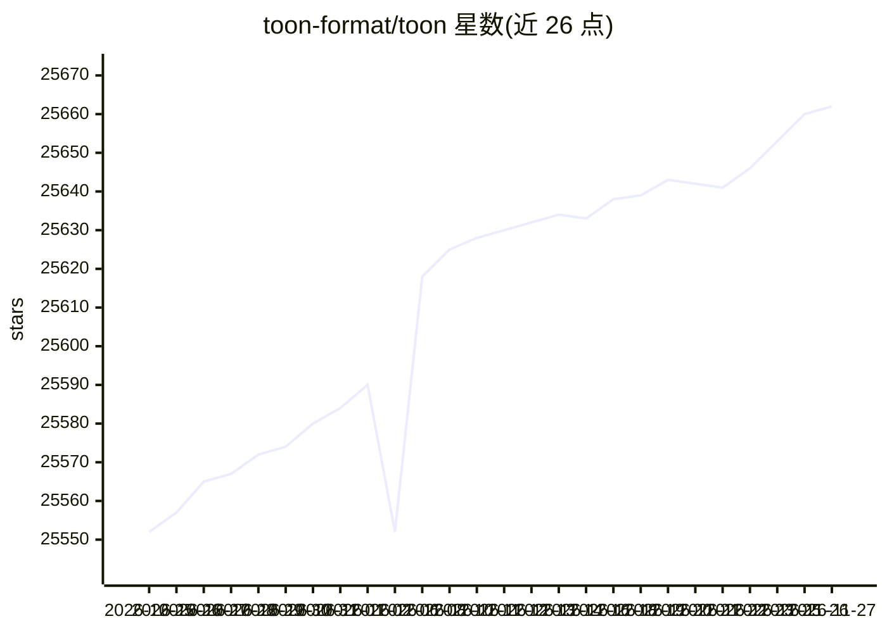

# toon-format/toon

⭐ 25,662 · TypeScript · MIT · 推送 2026-11-26 · [GitHub](https://github.com/toon-format/toon) · [官网](https://toonformat.dev) · 个人维护

**面向 LLM 提示词的 JSON 紧凑序列化格式与 TypeScript SDK**

TOON 定义一种紧凑、可读的 JSON 数据编码：用缩进表达嵌套结构，用 CSV 式表格形式表达同构数组/键控对象，声明 [N] 行数与 {fields} 字段列表以支持结构校验，往返无损。仓库提供 TypeScript SDK、CLI（npx 免安装转换并统计 token 节省）、规格文档与基准测试（4 个模型、244 个检索问题的 token 与准确率对比）。适用对象是向 LLM 传入结构化数据的开发者；README 同时列出不宜使用的场景（深度嵌套、非同构、纯表格数据）。

## 筛选速览

| 维度 | 判定 | 备注 |
|---|---|---|
| AI 角色 | `ai-ecosystem` | LLM/agent 周边工具 |
| 许可风险 | `permissive` | MIT |
| 部署形态 | `library` | 以包/库形式分发 |
| 模型依赖 | — | README 未给出锁定关系 |
| 硬件要求 | — | 无带数字的原话,不猜 |
| 安装摩擦 | `low` | 无编译、无系统依赖或容器化 |
| 成熟度 | — | 结构信号不足 |

## 动量与使用信号

- 维护:`active` — 距上次 push 9.0 天,年发版 32,47 位贡献者
- 涨星:近 1 天 **+2**(自 20261016 起算)
- 安装:npm 包 `@toon-format/cli` 月下载 95,244
- 平台:— · 协议:MCP

## 能力要点

- JSON 数据模型的无损编码，支持确定性往返转换
- 表格形式：同构对象声明一次字段列表，逐行输出
- [N]/{fields} 头部声明可校验截断或格式错误的输出
- 多语言实现生态共享同一规格与一致性测试套件

## 适用场景

- 向 LLM 提示词传入大量同构 JSON 数据时压缩 token
- CLI 快速评估自己的数据能省多少 token
- 需要 LLM 可靠解析并校验结构化输出的管线

## 场景标签

 · 领域:LLM 基础设施/数据格式

## 证据(README 行号)

> L11: **Token-Oriented Object Notation** is a compact, human-readable encoding of the JSON data model that minimizes toke
> L15: Think of it as a translation layer: use JSON programmatically, and encode it as TOON for LLM input – a drop-in, los
> L90: - 🌐 **Multi-Language Ecosystem:** Official implementations, plus dozens of community ports, all targeting one spec 

## 星数曲线

2026-10-25 25,552 → 2026-11-27 25,662（+110）

---
*卡片 v1 · prompt 1.4 · 生成 2026-11-26 · 置信度 high · 依据 README sha `f52b158da0a8` · [字段定义](../../DATASET.md)*
