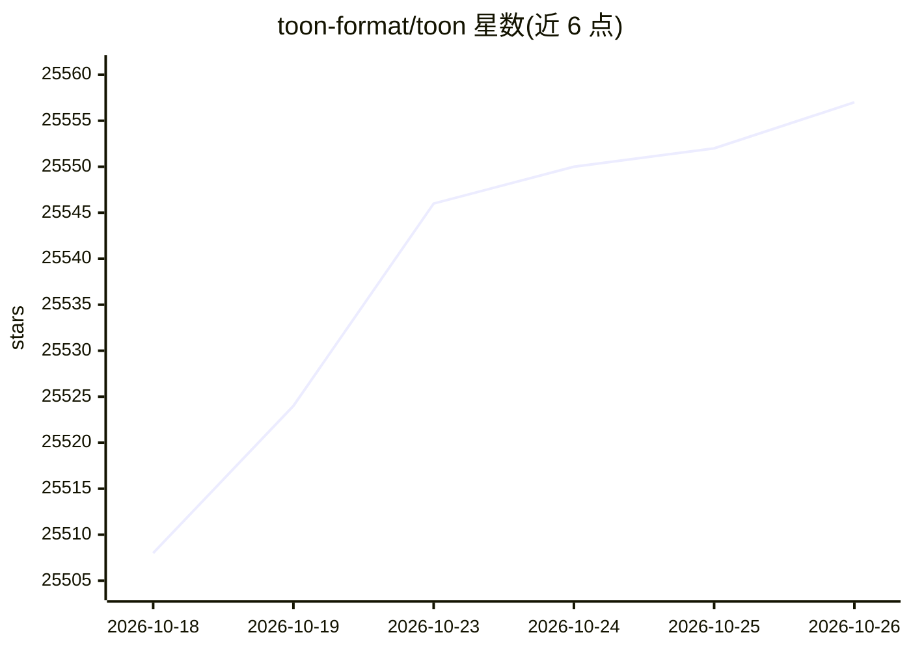

# toon-format/toon

⭐ 25,557 · TypeScript · MIT · 推送 2026-10-09 · [GitHub](https://github.com/toon-format/toon) · [官网](https://toonformat.dev) · 组织维护

**为 LLM 提示词设计的紧凑 JSON 序列化格式，降低 token 消耗**

定义了一种对 JSON 数据模型的紧凑、人类可读编码格式（SPEC v4.4）：用缩进替代大括号、对同构数组/键值集合采用表头声明一次的表格形式，提供长度 [N] 与字段 {fields} 声明以便模型解析与校验，并支持无损往返转换。附带 TypeScript SDK、CLI（npx @toon-format/cli，可统计 token 节省量）与基准测试：244 个数据检索问题、4 个模型，含按数据集与问题类型的准确率对比表。README 同时列出适用边界：深层嵌套或非同构数据、纯表格数据（CSV 更小）、延迟敏感场景不适用。MIT 许可。

## 筛选速览

| 维度 | 判定 | 备注 |
|---|---|---|
| AI 角色 | `ai-ecosystem` | LLM/agent 周边工具 |
| 许可风险 | `permissive` | MIT |
| 部署形态 | `library` | 以包/库形式分发 |
| 模型依赖 | — | README 未给出锁定关系 |
| 硬件要求 | — | 无带数字的原话,不猜 |
| 安装摩擦 | `low` | 无编译、无系统依赖或容器化 |
| 成熟度 | — | 结构信号不足 |

## 动量与使用信号

- 维护:`active` — 距上次 push 9.0 天,年发版 32,47 位贡献者
- 涨星:近 1 天 **+2**(自 20261016 起算)
- 安装:npm 包 `@toon-format/cli` 月下载 95,244
- 平台:— · 协议:MCP

## 能力要点

- JSON 数据模型的无损、确定性往返编码
- 表格形式对同构数据声明一次字段列表，逐行输出
- [N] 行数与 {fields} 字段声明提供截断/畸形输出防护
- 附 CLI（npx 免安装试用）与多模型、多格式基准测试

## 适用场景

- 把已有 JSON 数据编码进 LLM 提示词以减少 token 开销
- 需要模型输出可校验的结构化数据（行数/字段声明护栏）
- 评估不同序列化格式在自家模型上的 token 与准确率权衡

## 场景标签

`提示工程` · 领域:Agent 开发

## 证据(README 行号)

> L11: **Token-Oriented Object Notation** is a compact, human-readable encoding of the JSON data model that minimizes toke
> L15: Think of it as a translation layer: use JSON programmatically, and encode it as TOON for LLM input – a drop-in, los
> L90: - 🌐 **Multi-Language Ecosystem:** Official implementations, plus dozens of community ports, all targeting one spec 

## 星数曲线

2026-10-18 25,508 → 2026-10-26 25,557（+49）

---
*卡片 v1 · prompt 1.4 · 生成 2026-10-18 · 置信度 high · 依据 README sha `df5d8e91ca2c` · [字段定义](../../DATASET.md)*
