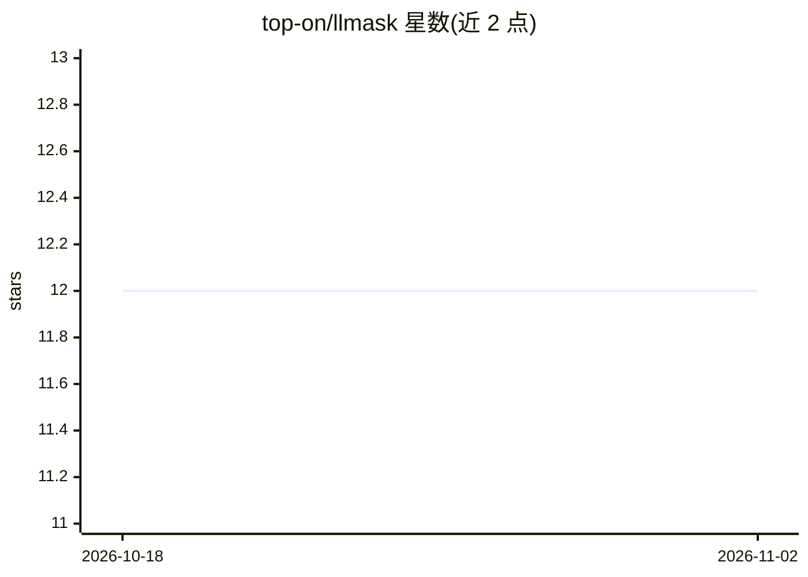

# top-on/llmask

⭐ 12 · Python · MIT · 推送 2026-10-26 · [GitHub](https://github.com/top-on/llmask) · 个人维护

**用 LLM 改写文风以隐匿文本作者身份的命令行工具**

Python 命令行工具 llmask：通过对文本施加一系列文风变换，用 LLM 改写以掩盖作者写作风格，主要用途为文本匿名化与保护举报者/活动者身份。输入输出支持管道处理。项目自称仅为 demo、pre-production 状态，已知限制包括变换种类有限、长链变换会产生伪影、敏感内容可能触发 LLM 审查、专名不做匿名化。示例工作流使用本地 ollama 服务模型，可在 CPU 运行，测试以 Apple Silicon 为主。经 pipx 安装。

## 筛选速览

| 维度 | 判定 | 备注 |
|---|---|---|
| AI 角色 | `ai-native` | 本体是模型或模型工具 |
| 许可风险 | `permissive` | MIT |
| 部署形态 | `None` |  |
| 模型依赖 | local-ok | 支持本地模型 |
| 硬件要求 | — | 无带数字的原话,不猜 |
| 安装摩擦 | `low` | 无编译、无系统依赖或容器化 |
| 成熟度 | `idea` | |

## 能力要点

- LLM 驱动的文风变换链，输出改写后文本
- 支持管道式批量处理（cat | llmask > output）
- 配合本地 ollama 运行模型，可 CPU 执行

## 适用场景

- 发布前匿名化自己的文本写作风格
- 保护举报者与活动者的身份特征
- 对抗文体计量（stylometry）分析

## 场景标签

`AI 写作` · 领域:内容生成

## 证据(README 行号)

> L3: A command-line tool for masking authorship of text,
> L4: by changing the writing style with a Large Language Model.

## 星数曲线

2026-10-18 12 → 2026-11-02 12（+0）

---
*卡片 v1 · prompt 1.4 · 生成 2026-10-31 · 置信度 high · 依据 README sha `4e51963185f4` · [字段定义](../../DATASET.md)*
