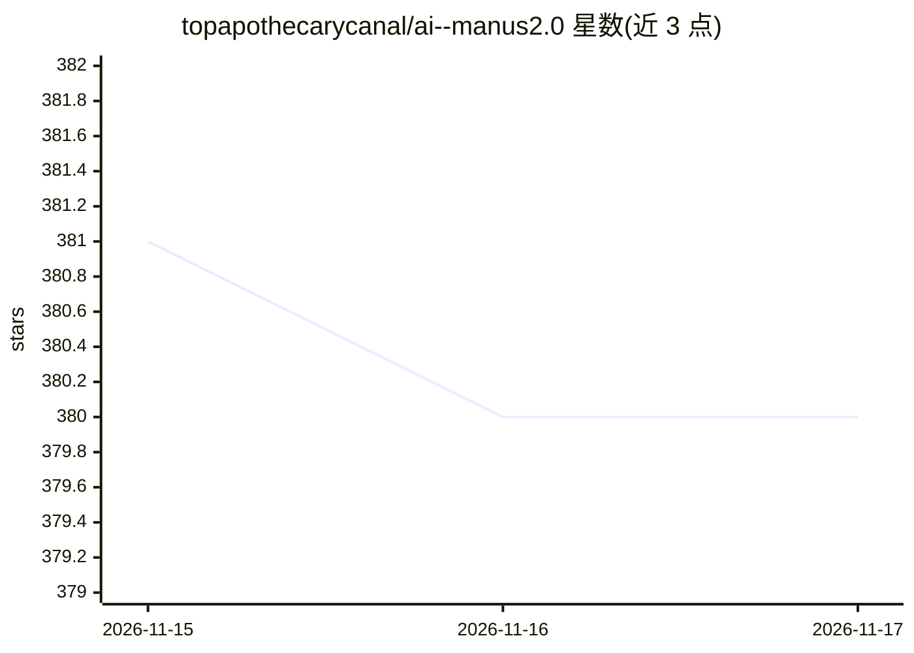

# topapothecarycanal/ai--manus2.0

⭐ 380 · Apache-2.0 · 推送 2026-11-15 · [GitHub](https://github.com/topapothecarycanal/ai--manus2.0) · 个人维护

**面向个人日常任务的自主 AI Agent：可执行代码并控制浏览器**

自称 Manus 的自主 AI Agent，面向家庭、学习与轻量办公用户：以自然指令驱动，可编写并执行脚本、控制浏览器（打开网页、填表、抓取信息），完成多步骤任务。核心机制是代码执行与浏览器操作在同一流程中衔接，任务可跨脚本与网页完成，并在多次会话中重复应用已识别的工作流模式。README 未给出具体安装命令、模型接入方式或代码仓库内容，仅列出系统兼容性表格（最低 4 GB 内存）与使用步骤说明，技术实现细节不可验证。

## 筛选速览

| 维度 | 判定 | 备注 |
|---|---|---|
| AI 角色 | `ai-native` | 本体是模型或模型工具 |
| 许可风险 | `permissive` | Apache-2.0 |
| 部署形态 | `None` |  |
| 模型依赖 | — | README 未给出锁定关系 |
| 硬件要求 | — | 无带数字的原话,不猜 |
| 安装摩擦 | `low` | 无编译、无系统依赖或容器化 |
| 成熟度 | — | 结构信号不足 |

## 能力要点

- 自主编写并执行脚本完成代码任务
- 浏览器控制：导航网页、填写表单、收集信息
- 代码与浏览器操作在同一任务流程中衔接
- 面向小规模场景（学习/家庭/轻办公），非企业平台

## 适用场景

- 让学生整理研究笔记、运行小脚本
- 远程工作者从多个网页收集数据并汇总
- 把重复的日常小任务交给后台代理处理
- 快速运行小型实验与测试脚本

## 场景标签

`AI 助手` · 领域:对话与助手

## 证据(README 行号)

> L10: - **Autonomous Code Execution:** Manus AI agent runs code on its own to complete tasks, so you can focus on decisio
> L18: Manus is an autonomous AI agent designed to run code and control a browser on your behalf. Instead of acting like a

## 星数曲线

2026-11-15 381 → 2026-11-17 380（-1）

---
*卡片 v1 · prompt 1.4 · 生成 2026-11-17 · 置信度 mid · 依据 README sha `71798a5b9c2b` · [字段定义](../../DATASET.md)*
