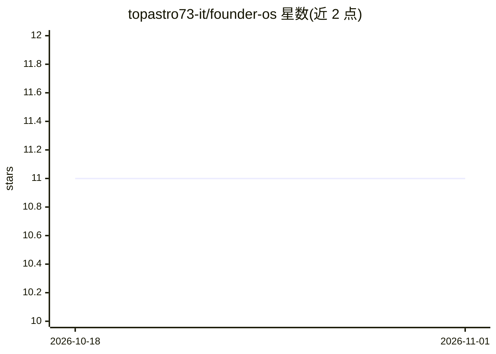

# topastro73-it/founder-os

⭐ 11 · Python · MIT · 推送 2026-08-24 · [GitHub](https://github.com/topastro73-it/founder-os) · 个人维护 · 中文 README

**在 Claude Code 内运行的 B2B SaaS 创业公司代理操作系统**

以纯 Markdown 组织的创业公司运营系统：10 个 AI 代理（CEO、产品、CTO、市场、销售、CFO、HR、法务等）读取共享公司上下文，执行斜杠命令，将产出写入对应目录并提交 git，使公司状态全部版本化。含约 28 个技能、5 个多代理工作流和系统协议层。安装方式为克隆仓库后在 Claude Code 中运行 /setup 向导。作者声明以 as-is 形式提供，不保证支持与更新。

## 筛选速览

| 维度 | 判定 | 备注 |
|---|---|---|
| AI 角色 | `ai-native` | 本体是模型或模型工具 |
| 许可风险 | `permissive` | MIT |
| 部署形态 | `None` |  |
| 模型依赖 | locked-api |  |
| 硬件要求 | — | 无带数字的原话,不猜 |
| 安装摩擦 | `low` | 无编译、无系统依赖或容器化 |
| 成熟度 | — | 结构信号不足 |

## 能力要点

- 10 个角色代理（CEO/产品/CTO/销售/CFO/HR/法务等）各自带人格、命令与模板
- 每条命令读取共享上下文、产出文件并提交 git，公司历史版本化
- 约 28 个技能与 5 个多代理工作流（功能生命周期、产品发布、季度规划等）
- /setup 向导通过约 10 个问题填充公司身份、团队、路线图与 KPI

## 适用场景

- 把创业公司的策略、产品、客户、财务统一在一个 git 仓库里管理
- 用 /pm、/sales 等命令让对应 AI 代理执行产品与销售任务
- 按参考示例 examples/acme-demo 搭建自己的公司运营结构

## 场景标签

`多智能体` `工作流自动化` · 领域:Agent 开发

## 证据(README 行号)

> L9: > Run your B2B SaaS startup like code. An agentic operating system you run inside Claude Code.
> L15: **founder-os** turns your repository into the single source of truth for your company. Instead of scattered docs, y
> L61:   → Claude reads .agents/product-manager/AGENT.md and becomes the PM

## 星数曲线

2026-10-18 11 → 2026-11-01 11（+0）

---
*卡片 v1 · prompt 1.4 · 生成 2026-11-01 · 置信度 high · 依据 README sha `a71e0e3e4881` · [字段定义](../../DATASET.md)*
