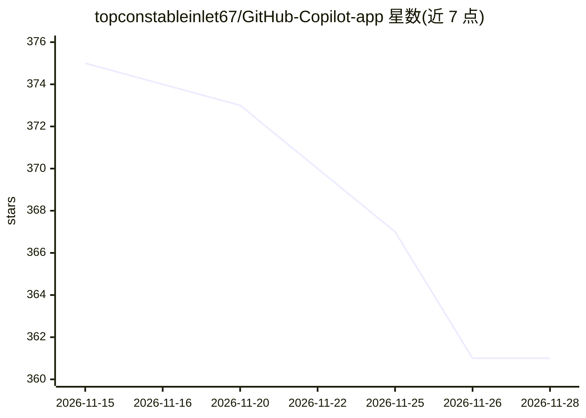

# topconstableinlet67/GitHub-Copilot-app

⭐ 361 · Apache-2.0 · 推送 2026-11-15 · [GitHub](https://github.com/topconstableinlet67/GitHub-Copilot-app) · 组织维护

**管理 GitHub 仓库中 agent 开发工作的桌面应用**

GitHub 官方的 agent 桌面应用：面向开发者在一个控制中心内查找要做的软件工作、启动与引导 Copilot agent、审查进度并落地变更。本地会话各自运行于隔离的 git worktree，云会话运行在 GitHub 托管的隔离环境；提供 Canvas 可视化 agent 工作面、My Work 汇总会话/issue/PR、Automations 定时任务与 Agent Merge 辅助合并。需 Git 与 Copilot 订阅（含免费版），也支持 BYOK 自带模型密钥；从 Releases 页下载安装包。

## 筛选速览

| 维度 | 判定 | 备注 |
|---|---|---|
| AI 角色 | `ai-ecosystem` | LLM/agent 周边工具 |
| 许可风险 | `permissive` | Apache-2.0 |
| 部署形态 | `desktop` | 安装包/桌面程序 |
| 模型依赖 | — | README 未给出锁定关系 |
| 硬件要求 | — | 无带数字的原话,不猜 |
| 安装摩擦 | `low` | 无编译、无系统依赖或容器化 |
| 成熟度 | — | 结构信号不足 |

## 能力要点

- 本地会话在隔离 git worktree 中并行运行 agent
- 云会话运行于 GitHub 托管的隔离环境
- Canvas 将计划、终端、diff 与工作流状态呈现为可检查编辑的共享面
- 支持 BYOK 自带模型密钥，无 Copilot 订阅亦可使用

## 适用场景

- 在一个桌面应用中跨仓库调度和监督多个 agent 开发会话
- 把重复性提示与工作流转为定时或后台任务
- 跟进 issue 与 pull request 的审查与合并

## 场景标签

`编码 Agent` `工作流自动化` · 领域:效率与自动化

## 证据(README 行号)

> L3: The GitHub Copilot app is an agent-native desktop experience for finding, running, steering, and landing software wo
> L13: The GitHub Copilot app is an agent-native desktop experience for managing software work from idea to pull request. 
> L15: The app is built for parallel agent-driven development. Each local session runs in its own isolated git worktree, a

## 星数曲线

2026-11-15 375 → 2026-11-28 361（-14）

---
*卡片 v1 · prompt 1.4 · 生成 2026-11-17 · 置信度 high · 依据 README sha `a85d674982eb` · [字段定义](../../DATASET.md)*
