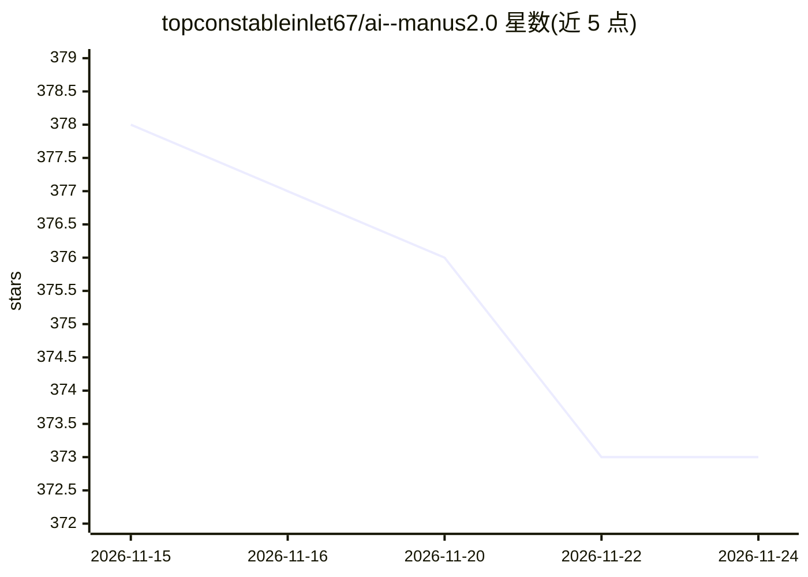

# topconstableinlet67/ai--manus2.0

⭐ 370 · Apache-2.0 · 推送 2026-11-15 · [GitHub](https://github.com/topconstableinlet67/ai--manus2.0) · 个人维护

**面向日常任务的自主 AI Agent：自行执行代码与浏览器操作**

Manus 是一个自主 AI 代理，定位为个人助手：用户以自然语言下达指令，代理自行编写并执行脚本、控制浏览器完成表单填写、信息收集、多步任务。README 说明其面向家庭、学习与轻量办公场景，非企业级平台，无需编程背景。兼容性表列出双核 CPU、4GB 内存起步等硬件要求；安装方式仅提及下载，未给出命令行或源码构建步骤，仓库内无可见技术实现细节。

## 筛选速览

| 维度 | 判定 | 备注 |
|---|---|---|
| AI 角色 | `ai-native` | 本体是模型或模型工具 |
| 许可风险 | `permissive` | Apache-2.0 |
| 部署形态 | `None` |  |
| 模型依赖 | — | README 未给出锁定关系 |
| 硬件要求 | — | 无带数字的原话,不猜 |
| 安装摩擦 | `low` | 无编译、无系统依赖或容器化 |
| 成熟度 | — | 结构信号不足 |

## 能力要点

- 代理自主编写并执行代码完成任务
- 浏览器控制：导航网页、填表、收集信息
- 脚本执行与浏览器操作可在同一任务流中衔接
- 面向学习/家庭/轻办公的小规模场景

## 适用场景

- 让学生整理研究笔记、运行小型计算脚本
- 远程工作者从多个网页收集并汇总数据
- 把重复性的小型日常任务委托给后台代理执行

## 场景标签

`AI 助手` `编码 Agent` `浏览器自动化` · 领域:效率与自动化

## 证据(README 行号)

> L10: - **Autonomous Code Execution:** Manus AI agent runs code on its own to complete tasks, so you can focus on decisio
> L18: Manus is an autonomous AI agent designed to run code and control a browser on your behalf. Instead of acting like a

## 星数曲线

2026-11-15 378 → 2026-11-24 373（-5）

---
*卡片 v1 · prompt 1.4 · 生成 2026-11-17 · 置信度 low · 依据 README sha `67d67f5ffeb2` · [字段定义](../../DATASET.md)*
