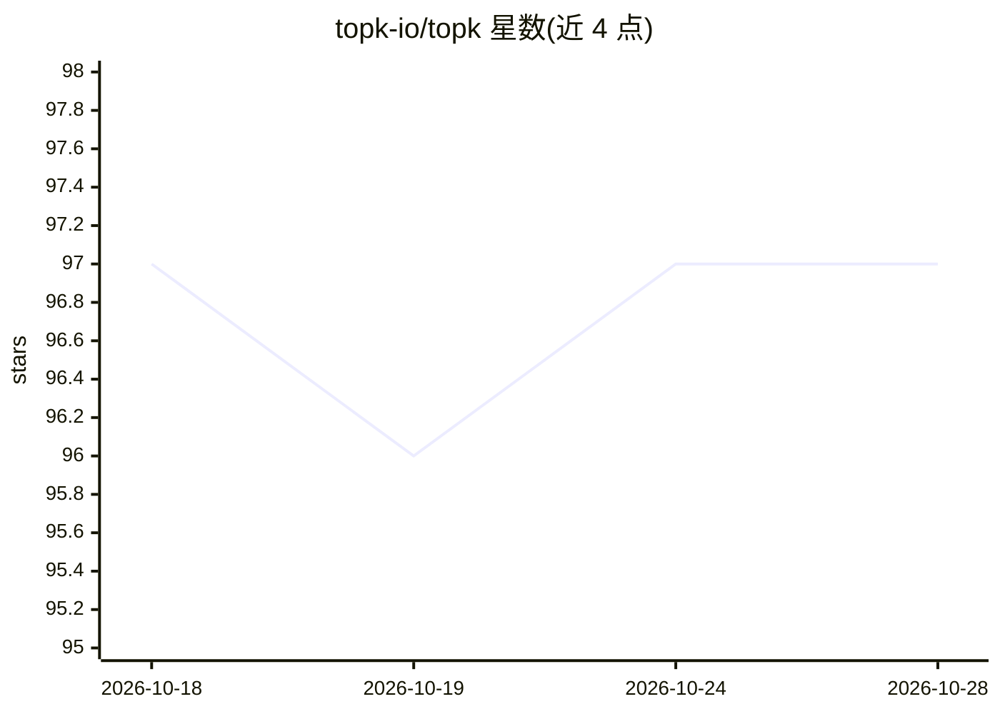

# topk-io/topk

⭐ 97 · Rust · MIT · 推送 2026-10-28 · [GitHub](https://github.com/topk-io/topk) · [官网](https://docs.topk.io) · 组织维护

**面向 AI 应用的统一检索引擎：混合/向量/关键词检索一体**

TopK 是统一检索引擎，在单一 API 中提供混合检索、向量检索、多向量检索、BM25 关键词检索、自定义排序表达式与托管推理；单一集合内存储稠密/稀疏向量、多向量嵌入与元数据，支持元数据过滤。基于对象存储构建，宣称以更低成本支撑大规模数据。提供 Python/JavaScript/Rust SDK、SQL 连接与 CLI，另提供供编码 agent 使用的 TopK skill（含 schema 设计、chunking、混合查询、多租户等指南）。

## 筛选速览

| 维度 | 判定 | 备注 |
|---|---|---|
| AI 角色 | `ai-ecosystem` | LLM/agent 周边工具 |
| 许可风险 | `permissive` | MIT |
| 部署形态 | `library` | 以包/库形式分发 |
| 模型依赖 | — | README 未给出锁定关系 |
| 硬件要求 | — | 无带数字的原话,不猜 |
| 安装摩擦 | `low` | 无编译、无系统依赖或容器化 |
| 成熟度 | — | 结构信号不足 |

## 能力要点

- 单一 API 覆盖混合/向量/多向量/BM25 检索与自定义排序
- 单一集合内存储稠密、稀疏、多向量嵌入与元数据
- 提供 Python/JavaScript/Rust SDK、SQL 连接与 CLI
- npx 一键安装面向编码 agent 的 TopK skill

## 适用场景

- 为 RAG 应用构建混合检索与向量检索后端
- 多租户场景下的嵌入式数据存储与过滤查询
- 让 Claude Code/Cursor 等编码 agent 生成正确的 TopK 代码

## 场景标签

`向量数据库` `语义搜索` · 领域:知识与检索

## 证据(README 行号)

> L3: TopK is a unified retrieval engine for hybrid search, vector search, multi-vector retrieval, keyword search (BM25) c
> L7: **Retrieval Engine** — Store and query dense vectors, sparse vectors, multi-vector embeddings, and metadata in a sin

## 星数曲线

2026-10-18 97 → 2026-10-28 97（+0）

---
*卡片 v1 · prompt 1.4 · 生成 2026-10-23 · 置信度 mid · 依据 README sha `bbd552f92812` · [字段定义](../../DATASET.md)*
