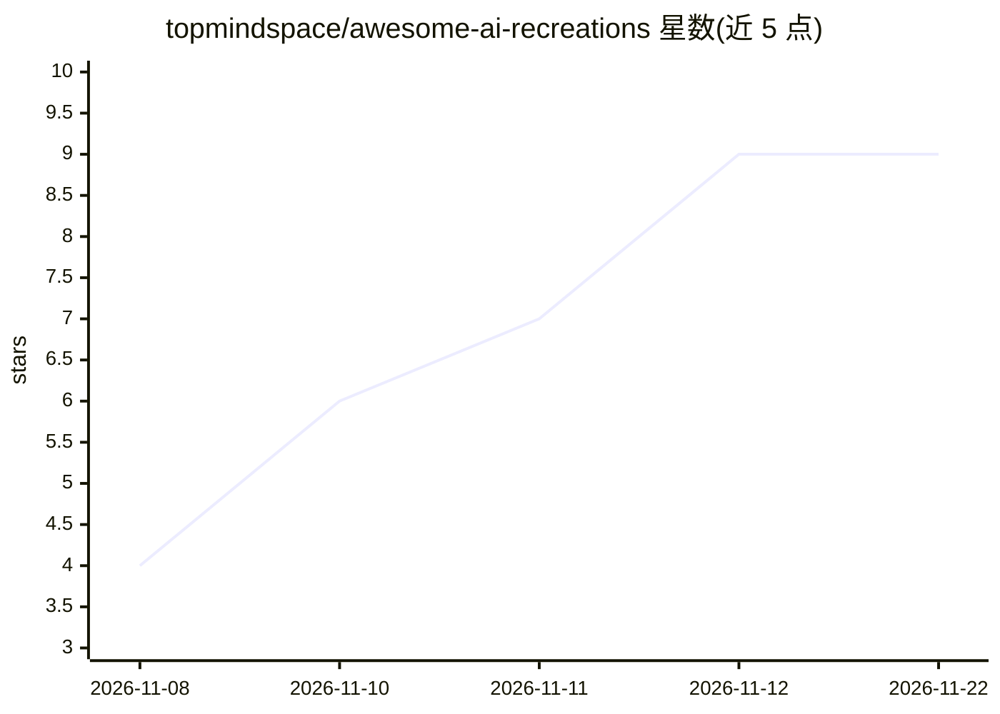

# topmindspace/awesome-ai-recreations

⭐ 9 · HTML · MIT · 推送 2026-11-14 · [GitHub](https://github.com/topmindspace/awesome-ai-recreations) · [官网](https://topmindspace.github.io/awesome-ai-recreations/) · 组织维护 · 中文 README

**把真实机械做成可拆解 3D 互动页的 AI 复刻案例集**

聚合由 AI Agent 复刻真实机械的案例集合：11 个案例（擎天柱、大黄蜂、机械章鱼、V8 发动机等）、21 个在线互动版本与本地短片版本，保存可运行作品、源码与原始参考。仓库内置一套把案例交给 Agent 跟做的流程：附可复制的提示词模板，Agent 按 AGENTS.md 查找任务与参考并自行实现验证；组织方对同条件比较的各 Agent 提供统一输入包。许可证为 MIT，第三方素材权利另行保留。

## 筛选速览

| 维度 | 判定 | 备注 |
|---|---|---|
| AI 角色 | `ai-knowledge` | 知识聚合/清单类 |
| 许可风险 | `permissive` | MIT |
| 部署形态 | `None` |  |
| 模型依赖 | — | README 未给出锁定关系 |
| 硬件要求 | — | 无带数字的原话,不猜 |
| 安装摩擦 | `low` | 无编译、无系统依赖或容器化 |
| 成熟度 | — | 结构信号不足 |

## 能力要点

- 11 个机械复刻案例、21 个在线互动/巡览版本
- 可直接粘贴给 Agent 的复刻提示词模板与 AGENTS.md 流程
- 同一案例下多个模型版本并列展示，附统一输入包比较机制
- 保存源码、剧照与制作验收资料

## 适用场景

- 查看各 AI Agent 复刻同一机械的实现效果与源码
- 把提示词模板交给 Agent 复刻 V8 发动机等案例
- 研究复刻演示的质量与可复用流程

## 场景标签

`精选清单` · 领域:学习与行业

## 证据(README 行号)

> L7: 我们保存可运行作品、源码、参考入口和制作方法。关注造型与动作还原、交互体验、材质与摄影、声音，以及从实现到实际交付的完整质量；把有效的方法与失败经验转化为下一次可以采用的流程。
> L26: 目前有 **11 个案例、21 个在线演示版本和 2 个本地短片版本**。点击「互动」操作作品，「巡览」打开自动演示。短片版本页收录剧照、制作与验收资料。

## 星数曲线

2026-11-08 4 → 2026-11-22 9（+5）

---
*卡片 v1 · prompt 1.4 · 生成 2026-11-20 · 置信度 high · 依据 README sha `c70bb4c5cf93` · [字段定义](../../DATASET.md)*
