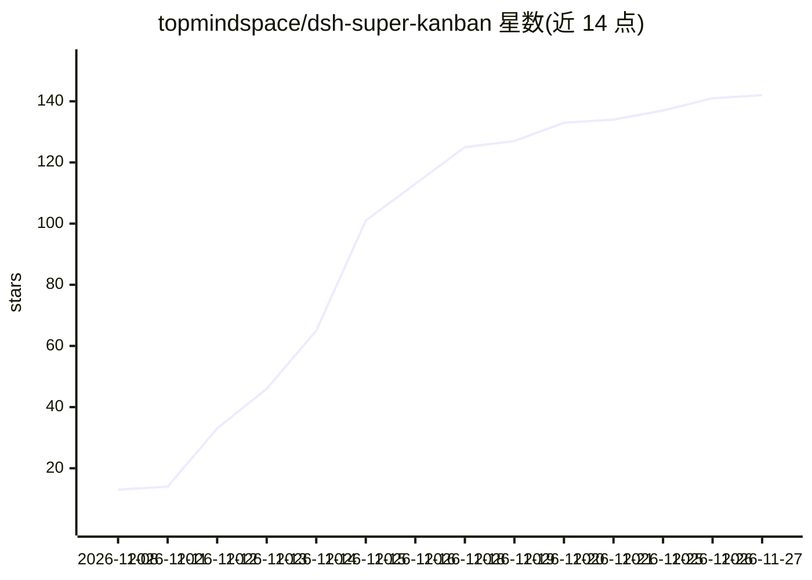

# topmindspace/dsh-super-kanban

⭐ 142 · JavaScript · MIT · 推送 2026-11-26 · [GitHub](https://github.com/topmindspace/dsh-super-kanban) · [官网](https://topmindspace.github.io/dsh-super-kanban/) · 个人维护 · 中文 README

**DSH 会话任务的 AI 看板插件：自动建卡、跟进与验收**

DeepSeek Harness（DSH）的任务看板插件，从多条 DSH 会话中增量扫描提取任务目标、进展、阻塞与交付物，生成并更新任务卡。核心机制包括：会话轮次结束触发的自动扫描、看板内直接审批工具权限与方案、交付物预览与人工验收确认、带上下文的会话交接草稿。看板有全局、右侧停靠与悬浮三种形态。启用 AI 研判需在 DSH 配置模型，扫描有每日研判单位预算；关闭 AI 研判时回退到本地规则扫描。任务数据存于本机，无遥测。

## 筛选速览

| 维度 | 判定 | 备注 |
|---|---|---|
| AI 角色 | `ai-enhanced` | 去掉 AI 部分产品仍成立 |
| 许可风险 | `permissive` | MIT |
| 部署形态 | `None` |  |
| 模型依赖 | — | README 未给出锁定关系 |
| 硬件要求 | — | 无带数字的原话,不猜 |
| 安装摩擦 | `low` | 无编译、无系统依赖或容器化 |
| 成熟度 | — | 结构信号不足 |

## 能力要点

- 增量扫描会话提取任务目标、进展、阻塞与交付物
- 看板内直接审批待执行命令与方案，保留跳回原会话入口
- 验收条件与交付物核对的确认验收流程
- 关闭 AI 研判时可回退本地规则扫描

## 适用场景

- 并行跑多条 DSH 会话时集中跟进哪些任务需要介入
- 在看板里核验 AI 产出物并确认验收
- 把未完成的任务带上下文交接给新会话继续做

## 场景标签

`工作流自动化` · 领域:效率与自动化

## 证据(README 行号)

> L58: - **共享模型选择** · 扫描、重新研判、润色和快聊共用看板选择。默认跟随 DSH，也可在工具栏选用 DSH 已配置的模型。关闭 AI 研判或模型不可用时，扫描使用本地规则。
> L91: 需要 DSH `>= 0.2.1-rc.5 < 0.3.0` 和 Node.js `>= 22.19.0`（DSH 自带）。macOS 桌面版已验证，其他桌面平台尚未逐一验证。插件无第三方运行时依赖。

## 星数曲线

2026-11-08 13 → 2026-11-27 142（+129）

---
*卡片 v1 · prompt 1.4 · 生成 2026-11-27 · 置信度 high · 依据 README sha `f51ccdbf294f` · [字段定义](../../DATASET.md)*
