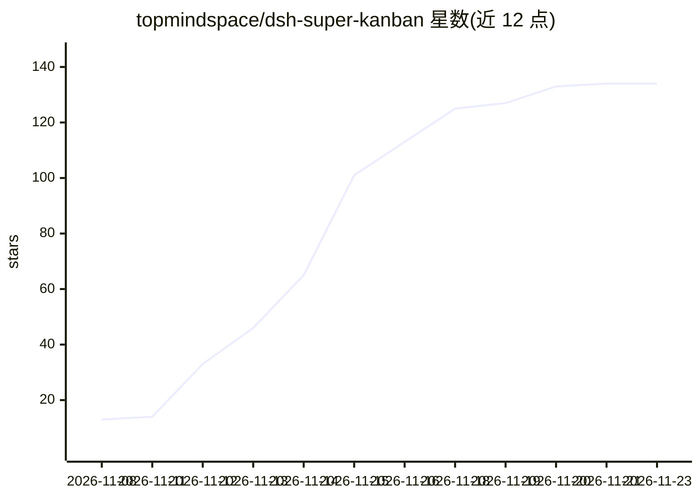

# topmindspace/dsh-super-kanban

⭐ 134 · JavaScript · MIT · 推送 2026-11-19 · [GitHub](https://github.com/topmindspace/dsh-super-kanban) · [官网](https://topmindspace.github.io/dsh-super-kanban/) · 组织维护 · 中文 README

**DeepSeek Harness 的 AI 任务看板插件：从会话提炼任务与进度**

运行在 DeepSeek Harness（DSH）内的插件，增量扫描多条 DSH 会话，用 AI 研判提取任务目标、进展、阻塞和交付物，生成并持续更新任务卡；提供全局/侧栏/悬浮三种看板视图、待审批卡片条、项目管理、时间线与日程、交付证据验收、带上下文续做草稿，以及流式快聊问答。模型与凭证在 DSH 侧配置，可跟随默认或指定模型，关闭 AI 研判时回退本地规则。兼容性要求 DSH >= 0.2.1-rc.5 < 0.3.0 和 Node.js >= 22.19.0。

## 筛选速览

| 维度 | 判定 | 备注 |
|---|---|---|
| AI 角色 | `ai-ecosystem` | LLM/agent 周边工具 |
| 许可风险 | `permissive` | MIT |
| 部署形态 | `None` |  |
| 模型依赖 | — | README 未给出锁定关系 |
| 硬件要求 | — | 无带数字的原话,不猜 |
| 安装摩擦 | `low` | 无编译、无系统依赖或容器化 |
| 成熟度 | — | 结构信号不足 |

## 能力要点

- 增量扫描会话提取任务目标、进展、阻塞与交付物并更新任务卡
- 全局、右侧停靠与悬浮三种看板视图及待审批卡片条
- 交付物证据预览、人工验收与带上下文的续做草稿
- 流式快聊问答，记录仅存当前窗口内存

## 适用场景

- 管理多个 AI 会话产生的任务，集中查看待审批与阻塞事项
- 按项目和时间线跟进多个工作区的 AI 工作进展
- 核对会话交付物并记录验收结果

## 场景标签

 · 领域:AI 会话任务管理/开发者工具插件

## 证据(README 行号)

> L3: **用 AI 自动整理 DSH 会话，用一张看板管理任务和项目。** Super Kanban 从 DeepSeek Harness（DSH）的多条会话中提炼任务，生成任务卡，并随会话推进更新进度、阻塞和交付物。打开看板就能看到哪些
> L43: - **AI 自动整理任务** · 增量扫描提取任务目标、进展、阻塞和交付物，用来创建或更新任务卡。同一任务可关联多条会话。开启自动扫描后，会话轮次结束可提前触发更新。
> L58: - **共享模型选择** · 扫描、重新研判、润色和快聊共用看板选择。默认跟随 DSH，也可在工具栏选用 DSH 已配置的模型。关闭 AI 研判或模型不可用时，扫描使用本地规则。

## 星数曲线

2026-11-08 13 → 2026-11-23 134（+121）

---
*卡片 v1 · prompt 1.4 · 生成 2026-11-17 · 置信度 high · 依据 README sha `1e0cb1699274` · [字段定义](../../DATASET.md)*
