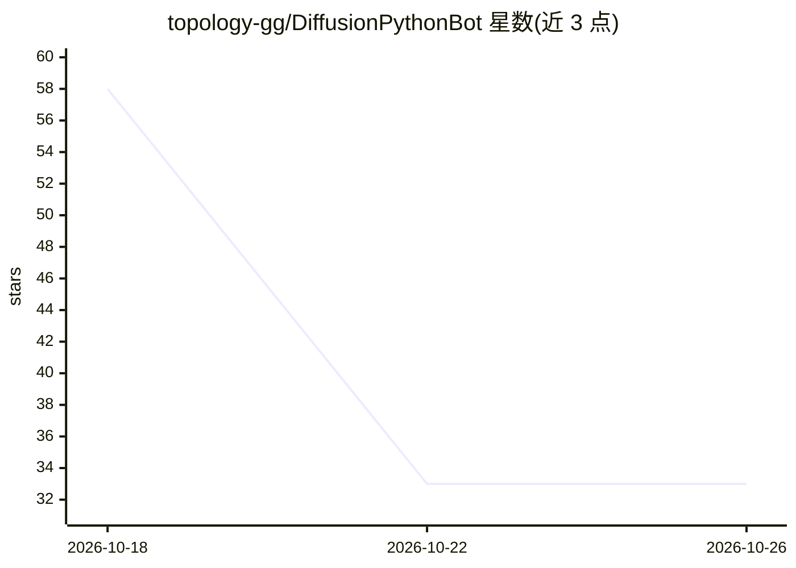

# topology-gg/DiffusionPythonBot

⭐ 33 · Python · MIT · 推送 2026-09-10 · [GitHub](https://github.com/topology-gg/DiffusionPythonBot) · 个人维护

**本地 Stable Diffusion 生图的 Discord 机器人**

Python 实现的 Discord 机器人，通过 PyTorch 在本地硬件上运行 Stable Diffusion 生图：`!generate` 命令按文本提示生成图片，@mention 并附带图片时执行 img2img。生成的图片经 imgur API 托管以突破 Discord 8M 上传限制（可至 25MiB）。配置文件控制 API 令牌、注意力缩放（换取显存）与各宽高比的最大分辨率，多台机器可提供不同质量等级。作者声明该项目为学习性质、功能基础。运行方式为源码克隆后 pip 安装依赖并用 poetry 启动。

## 筛选速览

| 维度 | 判定 | 备注 |
|---|---|---|
| AI 角色 | `ai-native` | 本体是模型或模型工具 |
| 许可风险 | `permissive` | MIT |
| 部署形态 | `library` | 以包/库形式分发 |
| 模型依赖 | — | README 未给出锁定关系 |
| 硬件要求 | — | 无带数字的原话,不猜 |
| 安装摩擦 | `low` | 无编译、无系统依赖或容器化 |
| 成熟度 | — | 结构信号不足 |

## 能力要点

- `!generate` 命令本地 PyTorch 文生图
- @mention 附图触发 img2img 流程
- imgur API 托管图片，上限 25MiB
- 注意力缩放选项与按宽高比的最大分辨率配置

## 适用场景

- 在 Discord 服务器里用命令生成图片
- 通过 @mention 附图做 img2img 二次创作
- 多台机器按各自硬件提供不同分辨率档位

## 场景标签

`图像生成` · 领域:内容生成

## 证据(README 行号)

> L3: This project is used for a Python-based Discord bot that can generate images locally using PyTorch via the `!generat
> L25: Generates an image on the bot's hardware using PyTorch. Syntax: `!generate <prompt>`

## 星数曲线

2026-10-18 58 → 2026-10-26 33（-25）

---
*卡片 v1 · prompt 1.4 · 生成 2026-10-25 · 置信度 mid · 依据 README sha `2de540ff8506` · [字段定义](../../DATASET.md)*
