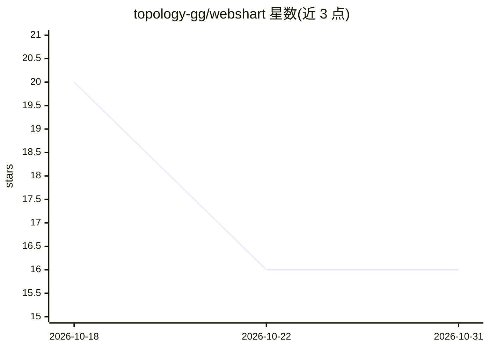

# topology-gg/webshart

⭐ 16 · Rust · MIT · 推送 2026-10-17 · [GitHub](https://github.com/topology-gg/webshart) · 组织维护

**面向 webdataset tar 分片的快速读取器与数据加载器**

Rust 核心加 Python 绑定的 webdataset tar 分片读取库：通过为每个 tar 生成独立 JSON 索引文件记录字节偏移，实现无需下载整档的随机访问、按需选择下载、HTTP range 请求与多分片并行读取；提供逻辑样本 API、按宽高做 aspect bucketing、caption 元数据归一与侧车文件合并。含 TarDataLoader（支持 state dict 断点续训）与 extract-metadata、optimize-captions、optimize-dataset 等 CLI 转换/上传工具，索引可上传至 Hugging Face 数据集仓库。要求 Python 3.12+，支持 Linux/macOS/Windows，MIT 许可。

## 筛选速览

| 维度 | 判定 | 备注 |
|---|---|---|
| AI 角色 | `ai-ecosystem` | LLM/agent 周边工具 |
| 许可风险 | `permissive` | MIT |
| 部署形态 | `library` | 以包/库形式分发 |
| 模型依赖 | — | README 未给出锁定关系 |
| 硬件要求 | — | 无带数字的原话,不猜 |
| 安装摩擦 | `low` | 无编译、无系统依赖或容器化 |
| 成熟度 | — | 结构信号不足 |

## 能力要点

- JSON 索引分片格式：随机访问、选择下载、HTTP range 请求、多分片并行
- Rust 实现：无 GIL 并行、零拷贝、tokio 异步运行时、连接池
- TarDataLoader 支持 state dict 确定性恢复训练
- CLI 支持为任意 tar 数据集生成索引并上传 Hugging Face

## 适用场景

- 流式加载大规模图像/视频 webdataset 做训练
- 不下载整个数据集获取统计信息或数据子集
- 为现有 tar 数据集生成索引并分享给社区
- 按图像形状分桶（aspect bucketing）组织训练数据

## 场景标签

`MLOps` · 领域:训练与推理

## 证据(README 行号)

> L3: Fast dataloader and conversion utility for webdataset tar shards. Rust core with Python bindings.
> L22: - **Cloud-optimized**: Works efficiently with HTTP range requests
> L261: loader = webshart.TarDataLoader(dataset)

## 星数曲线

2026-10-18 20 → 2026-10-31 16（-4）

---
*卡片 v1 · prompt 1.4 · 生成 2026-10-30 · 置信度 high · 依据 README sha `f3113d094954` · [字段定义](../../DATASET.md)*
