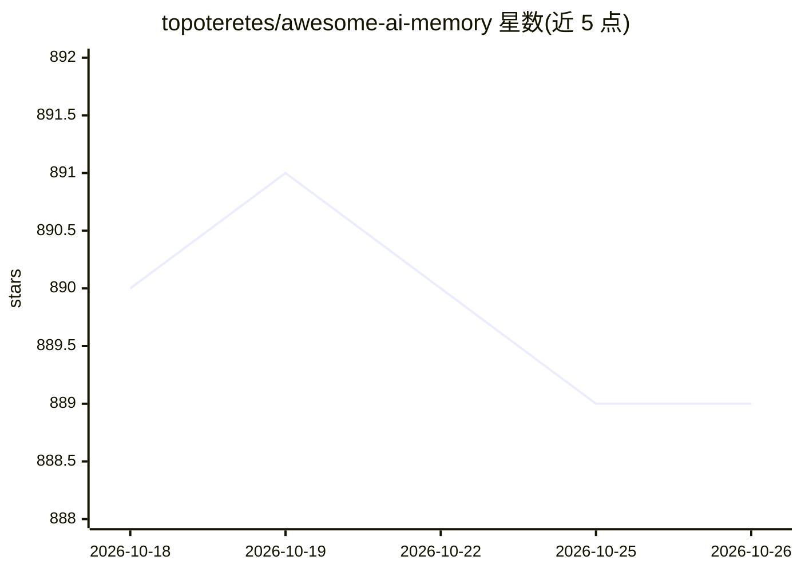

# topoteretes/awesome-ai-memory

⭐ 889 · Python · Apache-2.0 · 推送 2026-08-24 · [GitHub](https://github.com/topoteretes/awesome-ai-memory) · [官网](https://github.com/topoteretes/cognee) · 组织维护

**为 AI 应用与 agent 提供记忆能力的工具/框架/存储策展清单**

由 topoteretes 维护的 AI memory 项目聚合清单：收录内存工具、LLM 框架、优化器与存储层数据库等约 40+ 个条目，按开源/托管/闭源、Memory Tool/Framework/Optimizer/Storage 分类、Graph/Vector 存储表示三个维度标注。README 另附 AI memory 类型说明（短期/长期，情景/语义/程序性）。清单开头与多处推广维护方自身的 cognee 项目。

## 筛选速览

| 维度 | 判定 | 备注 |
|---|---|---|
| AI 角色 | `ai-knowledge` | 知识聚合/清单类 |
| 许可风险 | `permissive` | Apache-2.0 |
| 部署形态 | `None` |  |
| 模型依赖 | — | README 未给出锁定关系 |
| 硬件要求 | — | 无带数字的原话,不猜 |
| 安装摩擦 | `low` | 无编译、无系统依赖或容器化 |
| 成熟度 | — | 结构信号不足 |

## 能力要点

- 按开源属性、技术栈角色、Graph/Vector 存储三个维度标注条目
- 覆盖 mem0、Zep、MemGPT、Chroma、Qdrant 等内存工具与向量库
- 附短期/长期记忆（情景、语义、程序性）的概念说明

## 适用场景

- 为 AI agent 挑选带记忆能力的开源工具或托管服务
- 比较各内存方案的图/向量存储实现方式
- 了解 AI memory 生态中框架、优化器与存储层的分工

## 场景标签

`Agent 记忆` `精选清单` · 领域:Agent 开发

## 证据(README 行号)

> L3: > A curated list of tools, frameworks, optimizers, and storage layers that give AI apps and agents memory.
> L28: |Name|URL|Open / Close|GitHub URL|Category|Storage|

## 星数曲线

2026-10-18 890 → 2026-10-26 889（-1）

---
*卡片 v1 · prompt 1.4 · 生成 2026-10-21 · 置信度 high · 依据 README sha `4e85d1880fe9` · [字段定义](../../DATASET.md)*
