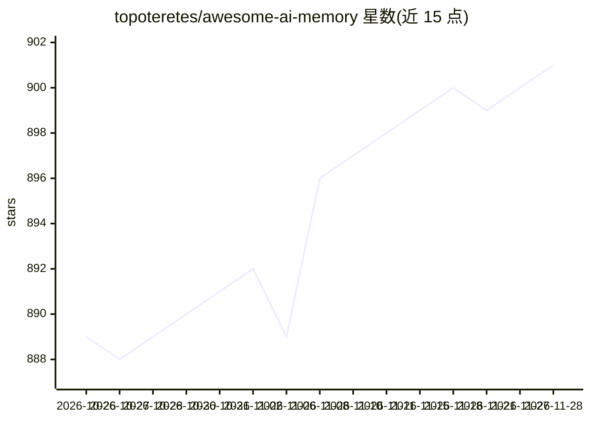

# topoteretes/awesome-ai-memory

⭐ 901 · HTML · Apache-2.0 · 推送 2026-11-18 · [GitHub](https://github.com/topoteretes/awesome-ai-memory) · [官网](https://github.com/topoteretes/cognee) · 组织维护

**为 AI 应用与 agent 挑选记忆工具的策展清单**

由 Cognee 团队（topoteretes）维护的 AI 记忆生态清单：收录记忆工具、LLM 框架、优化器与存储层等项目，并按开源/闭源、Graph/Vector 存储、类别（Memory Tool/Framework/Optimizer/Storage/Security）三个维度打标。清单附带 AI 记忆类型说明（短期/长期、情景/语义/程序性）与使用指南，通过 pull request 接受社区补充。清单本身不提供安装或运行方式，条目均含官网与 GitHub 链接。

## 筛选速览

| 维度 | 判定 | 备注 |
|---|---|---|
| AI 角色 | `ai-knowledge` | 知识聚合/清单类 |
| 许可风险 | `permissive` | Apache-2.0 |
| 部署形态 | `library` | 以包/库形式分发 |
| 模型依赖 | — | README 未给出锁定关系 |
| 硬件要求 | — | 无带数字的原话,不猜 |
| 安装摩擦 | `low` | 无编译、无系统依赖或容器化 |
| 成熟度 | — | 结构信号不足 |

## 能力要点

- 按开源/闭源、存储类型、栈位三维度为条目打标
- 收录记忆工具、框架、优化器、存储层等条目并附链接
- 提供 AI 记忆类型（短期/长期/情景/语义/程序性）说明

## 适用场景

- 为 agent 项目选择合适的持久记忆工具
- 比较向量库与图数据库在记忆层的适用性
- 了解 AI 记忆生态的项目分布与分类

## 场景标签

`精选清单` `Agent 记忆` · 领域:Agent 开发

## 证据(README 行号)

> L3: > A curated list of tools, frameworks, optimizers, and storage layers that give AI apps and agents memory.
> L28: |Name|URL|Open / Close|GitHub URL|Category|Storage|
> L79: ## How to use this list

## 星数曲线

2026-10-26 889 → 2026-11-28 901（+12）

---
*卡片 v1 · prompt 1.4 · 生成 2026-11-24 · 置信度 mid · 依据 README sha `92ca4dc0c4e2` · [字段定义](../../DATASET.md)*
