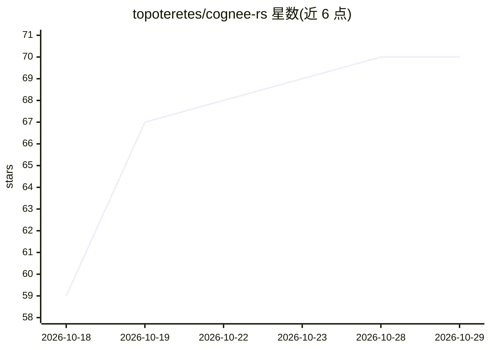

# topoteretes/cognee-rs

⭐ 70 · Rust · Apache-2.0 · 推送 2026-10-28 · [GitHub](https://github.com/topoteretes/cognee-rs) · [官网](https://www.cognee.ai) · 组织维护

**Rust 实现的设备端 AI 记忆引擎：把文本/文件/URL 变为可查询知识图谱**

Cognee 的 Rust 实现：通过 remember/recall/improve/forget 四动词记忆 API，将原始文本、文件和 URL 摄入并构建知识图谱，recall 自动路由检索方式，支持会话级瞬态记忆与按数据集/条目删除。默认嵌入 SQLite+Ladybug+LanceDB 全本地栈，需 OpenAI 兼容 LLM API key，嵌入与 LLM 可切换到 ONNX/Ollama 本地运行。以 cognee-cli 二进制与 cognee-lib crate 形式提供，另有 JS/Python/C/Java 四种语言绑定（Python 尚未上 PyPI）。限制：跨进程图存储锁不在范围内；Rust 高层 API 需先手工组装组件。

## 筛选速览

| 维度 | 判定 | 备注 |
|---|---|---|
| AI 角色 | `ai-ecosystem` | LLM/agent 周边工具 |
| 许可风险 | `permissive` | Apache-2.0 |
| 部署形态 | `library` | 以包/库形式分发 |
| 模型依赖 | local-ok | 支持本地模型 |
| 硬件要求 | — | 无带数字的原话,不猜 |
| 安装摩擦 | `medium` | 含编译或系统依赖之一 |
| 成熟度 | — | 结构信号不足 |

## 能力要点

- remember/recall/improve/forget 四动词记忆 API，recall 自动路由检索
- 默认全嵌入式本地栈：SQLite + Ladybug 图存储 + LanceDB 向量库
- 支持 Ollama/ONNX 全本地运行 LLM 与嵌入
- 提供 JS/Python/C/Java 四种语言绑定与 OpenTelemetry 观测

## 适用场景

- 为 AI agent/应用构建持久化、可查询的记忆层
- 本地离线运行知识图谱摄入与检索
- 在 Rust 项目中以库形式集成记忆能力

## 场景标签

`知识图谱` `RAG` `Agent 记忆` · 领域:Agent 开发

## 证据(README 行号)

> L7: **On-device AI memory in Rust.** Turn raw text, files, and URLs into a
> L21: The four-verb **memory API** (`remember` / `recall` / `improve` / `forget`)
> L62: The default feature set wires the fully embedded, no-external-service stack:

## 星数曲线

2026-10-18 59 → 2026-10-29 70（+11）

---
*卡片 v1 · prompt 1.4 · 生成 2026-10-24 · 置信度 mid · 依据 README sha `bb570fbc5b71` · [字段定义](../../DATASET.md)*
