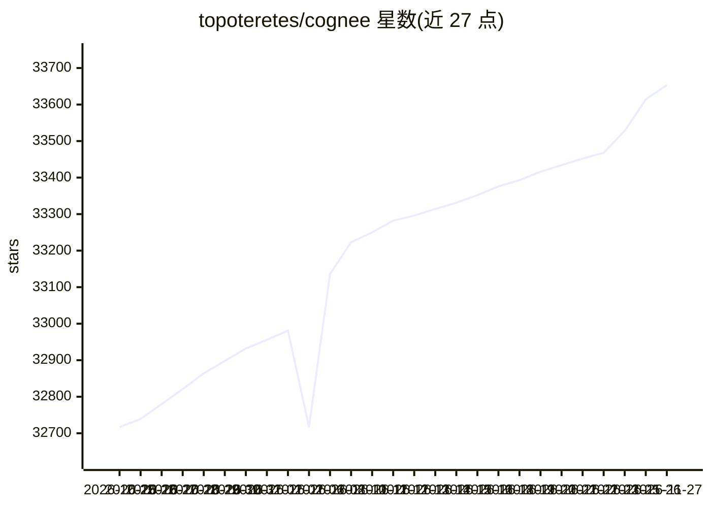

# topoteretes/cognee

⭐ 33,653 · Python · Apache-2.0 · 推送 2026-11-26 · [GitHub](https://github.com/topoteretes/cognee) · [官网](https://www.cognee.ai) · 组织维护 · 中文 README

**为 AI agent 提供持久长期记忆的开源知识图谱平台**

Cognee 将文档、代码与会话内容转换为可检索、可复用的持久知识图谱，供 agent 跨会话使用。提供 remember/recall/improve/forget 四种记忆操作，检索支持图、向量与代码上下文路由。默认路径用本地 GLiNER 抽取与本地嵌入模型，在 CPU 上运行且无需 API key；配置 LLM key 后可获得生成式回答。以 Python 包分发，另带 CLI、本地 UI、REST API 与 Docker 部署方式，提供 Claude Code/Codex/MCP 插件及 TypeScript/Rust SDK。

## 筛选速览

| 维度 | 判定 | 备注 |
|---|---|---|
| AI 角色 | `ai-ecosystem` | LLM/agent 周边工具 |
| 许可风险 | `permissive` | Apache-2.0 |
| 部署形态 | `self-host` | docker 或自建部署 |
| 模型依赖 | local-ok | 支持本地模型 |
| 硬件要求 | — | 无带数字的原话,不猜 |
| 安装摩擦 | `low` | 无编译、无系统依赖或容器化 |
| 成熟度 | — | 结构信号不足 |

## 动量与使用信号

- 维护:`active` — 距上次 push 1.5 天,年发版 92,296 位贡献者
- 涨星:近 1 天 **+56**(自 20261016 起算)
- 安装:pypi 包 `cognee` 月下载 86,048
- 平台:— · 协议:MCP / OLLAMA

## 能力要点

- 无 LLM key 时用本地 GLiNER 模型完成图谱抽取与检索
- remember/recall/improve/forget 四类记忆操作与会话知识蒸馏
- 支持从 Mem0、Letta、Zep、Graphiti 经 COGX 格式导入记忆
- 提供 Docker 镜像、docker compose 部署及 Claude Code/Codex/MCP 插件

## 适用场景

- 给我的 agent 加上跨会话的持久项目记忆
- 把团队文档、工单和代码汇成可查询的 Company Brain
- 在单机 CPU 上无 API key 地构建和检索知识图谱
- 用 Docker Compose 在自己服务器上跑记忆 API 服务

## 场景标签

`Agent 记忆` `知识图谱` `RAG` `编码 Agent` · 领域:Agent 开发

## 证据(README 行号)

> L32:  Cognee is a free open-source AI memory platform that gives AI agents persistent long-term memory across sessions. 
> L65: |Give an existing agent memory|Plugins and MCP|
> L134: At query time, retrieval selects relevant graph, vector, or code context. Your application can inspect the retriev

## 星数曲线

2026-10-25 32,717 → 2026-11-27 33,653（+936）

---
*卡片 v1 · prompt 1.4 · 生成 2026-11-22 · 置信度 high · 依据 README sha `afe5a9004f26` · [字段定义](../../DATASET.md)*
