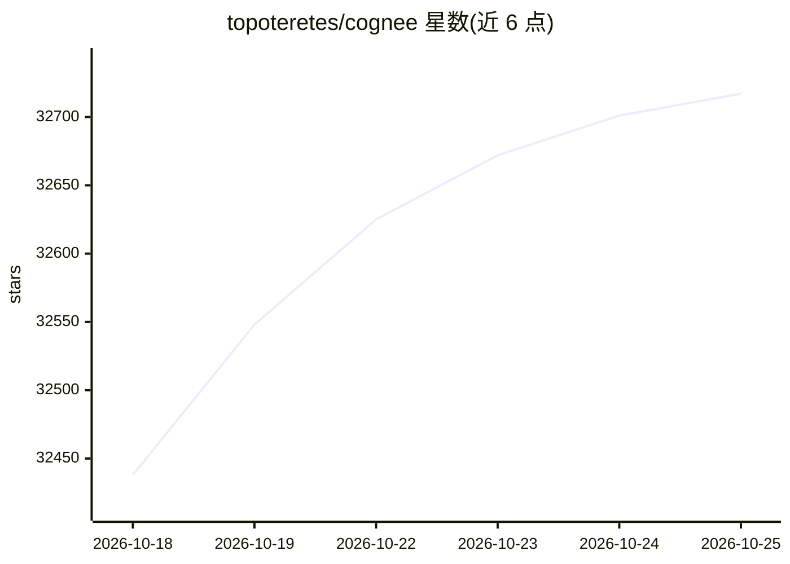

# topoteretes/cognee

⭐ 32,717 · Python · Apache-2.0 · 推送 2026-10-23 · [GitHub](https://github.com/topoteretes/cognee) · [官网](https://www.cognee.ai) · 组织维护 · 中文 README

**给 AI agent 提供持久长期记忆的开源知识图谱平台**

将文档、代码与会话内容转化为可自托管的知识图谱，agent 可在多次会话间存储（remember）、检索（recall）、增补（improve）和删除（forget）记忆。默认路径使用本地 GLiNER 抽取与本地嵌入模型，无需 API key 即可在 CPU 上运行；配置 LLM key 后可生成回答，支持 OpenAI 或本地 Ollama。提供 Python 库、CLI、REST API、MCP server 及 Claude Code/Codex 插件，支持 Docker Compose 部署，Postgres 单机整合当前为 demo 特性。

## 筛选速览

| 维度 | 判定 | 备注 |
|---|---|---|
| AI 角色 | `ai-native` | 本体是模型或模型工具 |
| 许可风险 | `permissive` | Apache-2.0 |
| 部署形态 | `self-host` | docker 或自建部署 |
| 模型依赖 | local-ok | 支持本地模型 |
| 硬件要求 | — | 无带数字的原话,不猜 |
| 安装摩擦 | `low` | 无编译、无系统依赖或容器化 |
| 成熟度 | — | 结构信号不足 |

## 动量与使用信号

- 维护:`active` — 距上次 push 1.5 天,年发版 92,296 位贡献者
- 涨星:近 1 天 **+56**(自 20261016 起算)
- 安装:pypi 包 `cognee` 月下载 86,048
- 平台:— · 协议:MCP / OLLAMA

## 能力要点

- 无 LLM key 时用本地 GLiNER 与嵌入模型在 CPU 上构建图谱
- remember/recall/improve/forget 四种记忆操作
- Claude Code、Codex、OpenClaw、MCP 客户端等多种接入接口
- Docker 镜像内置 GLiNER 运行时，可用 COGX 格式从 Mem0/Letta/Zep/Graphiti 导入

## 适用场景

- 为 agent 保留跨会话的项目上下文与历史决策
- 把团队文档、工单、代码汇入共享的 Company Brain
- 在自有基础设施上运行自托管记忆层
- 从其他记忆方案（Mem0/Letta/Zep/Graphiti）迁移记忆数据

## 场景标签

`Agent 记忆` `知识图谱` · 领域:Agent 开发

## 证据(README 行号)

> L32:  Cognee is a free open-source AI memory platform that gives AI agents persistent long-term memory across sessions. 
> L34:  Runs locally for free — no API key required.
> L116: Once a key is set, Cognee uses OpenAI for language models and embeddings, and processing and generated answers mak

## 星数曲线

2026-10-18 32,438 → 2026-10-25 32,717（+279）

---
*卡片 v1 · prompt 1.4 · 生成 2026-10-18 · 置信度 high · 依据 README sha `9715d6a9171c` · [字段定义](../../DATASET.md)*
