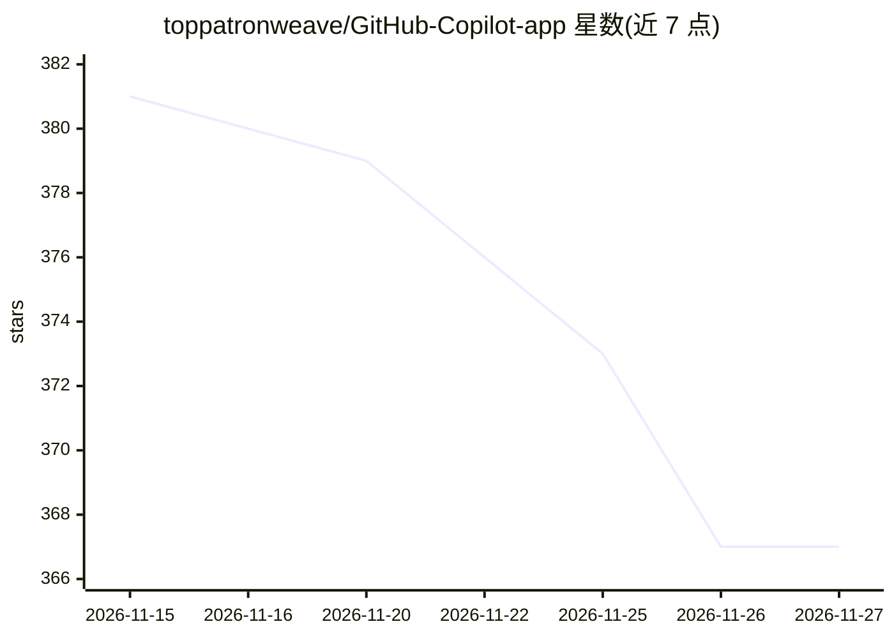

# toppatronweave/GitHub-Copilot-app

⭐ 367 · Apache-2.0 · 推送 2026-11-15 · [GitHub](https://github.com/toppatronweave/GitHub-Copilot-app) · 组织维护

**面向 GitHub 仓库的 agent 驱动软件开发桌面应用**

GitHub 官方仓库发布的桌面应用，用于查找、运行、引导和落地跨 GitHub 仓库的软件工作：本地会话运行在独立 git worktree，云会话在 GitHub 托管的隔离环境中运行；提供 Canvas 查看与编辑 agent 工作、My Work 汇总会话/issue/PR、Automations 定时任务与 Agent Merge 辅助合并。需 Git 与 Copilot 订阅（含免费版），支持 BYOK 自带模型密钥。从下载链接与 Releases 页获取安装包。

## 筛选速览

| 维度 | 判定 | 备注 |
|---|---|---|
| AI 角色 | `ai-ecosystem` | LLM/agent 周边工具 |
| 许可风险 | `permissive` | Apache-2.0 |
| 部署形态 | `desktop` | 安装包/桌面程序 |
| 模型依赖 | — | README 未给出锁定关系 |
| 硬件要求 | — | 无带数字的原话,不猜 |
| 安装摩擦 | `low` | 无编译、无系统依赖或容器化 |
| 成熟度 | — | 结构信号不足 |

## 能力要点

- 本地会话各自运行于隔离 git worktree，支持并行 agent 开发
- Canvas 将 agent 计划、终端、diff 与工作流状态呈现为可检查界面
- Automations 将提示与工作流转为定时/后台任务，Agent Merge 辅助 PR 走完评审与合并
- 支持 BYOK 自带模型提供商，无 Copilot 订阅亦可使用

## 适用场景

- 并行派发多个 Copilot agent 处理 bug、issue 与评审反馈
- 在同一界面管理跨仓库的会话、issue 与 pull request
- 用定时任务自动执行重复性提示与工作流

## 场景标签

`编码 Agent` · 领域:编码与开发

## 证据(README 行号)

> L13: The GitHub Copilot app is an agent-native desktop experience for managing software work from idea to pull request. 
> L15: The app is built for parallel agent-driven development. Each local session runs in its own isolated git worktree, a

## 星数曲线

2026-11-15 381 → 2026-11-27 367（-14）

---
*卡片 v1 · prompt 1.4 · 生成 2026-11-17 · 置信度 high · 依据 README sha `a85d674982eb` · [字段定义](../../DATASET.md)*
