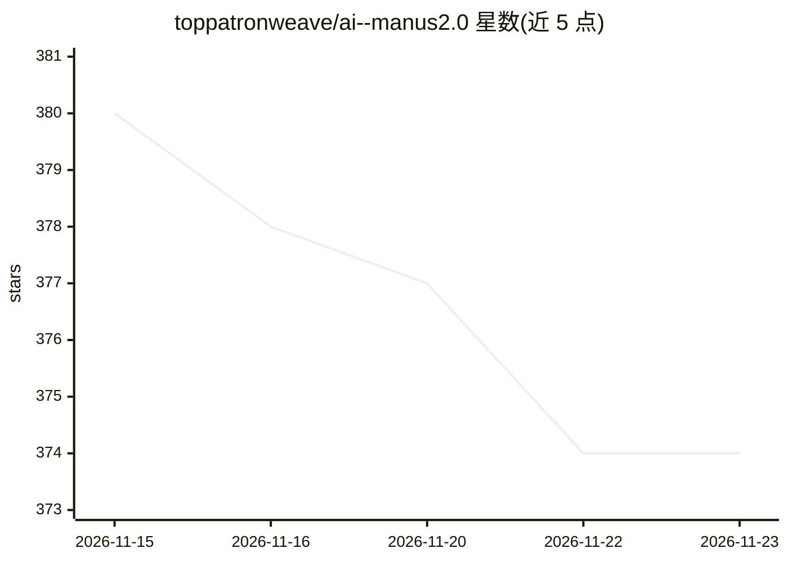

# toppatronweave/ai--manus2.0

⭐ 374 · Apache-2.0 · 推送 2026-11-15 · [GitHub](https://github.com/toppatronweave/ai--manus2.0) · 个人维护

**面向个人用户的自主 AI Agent：代为执行代码与浏览器操作**

Manus 定位为自主 AI Agent，可在用户授权下编写并执行脚本、控制浏览器完成页面导航、表单填写与信息收集，支持跨脚本与浏览器的多步骤任务，并以个人助理形式在后台待命。README 面向学生、远程工作者与轻度办公用户，标称无需编程背景。README 仅给出组件兼容性表与使用步骤描述，未提供具体安装命令、源码结构或模型接入方式；下载入口为“Download Manus”链接并附促销代码 PROMO2026。

## 筛选速览

| 维度 | 判定 | 备注 |
|---|---|---|
| AI 角色 | `ai-native` | 本体是模型或模型工具 |
| 许可风险 | `permissive` | Apache-2.0 |
| 部署形态 | `None` |  |
| 模型依赖 | — | README 未给出锁定关系 |
| 硬件要求 | — | 无带数字的原话,不猜 |
| 安装摩擦 | `low` | 无编译、无系统依赖或容器化 |
| 成熟度 | — | 结构信号不足 |

## 能力要点

- 自主编写并执行代码以完成任务
- 浏览器控制：导航网页、填写表单、收集信息
- 脚本与浏览器动作可在同一任务流中衔接
- 以个人助理形式在后台响应任务委托

## 适用场景

- 学习与调研时代为收集参考资料、运行小脚本
- 代替人工完成重复的网页检查与文件整理
- 轻度办公中从多标签页收集信息并准备摘要

## 场景标签

`AI 助手` `浏览器自动化` `编码 Agent` · 领域:效率与自动化

## 证据(README 行号)

> L10: - **Autonomous Code Execution:** Manus AI agent runs code on its own to complete tasks, so you can focus on decisio
> L18: Manus is an autonomous AI agent designed to run code and control a browser on your behalf. Instead of acting like a

## 星数曲线

2026-11-15 380 → 2026-11-23 374（-6）

---
*卡片 v1 · prompt 1.4 · 生成 2026-11-17 · 置信度 low · 依据 README sha `67d67f5ffeb2` · [字段定义](../../DATASET.md)*
