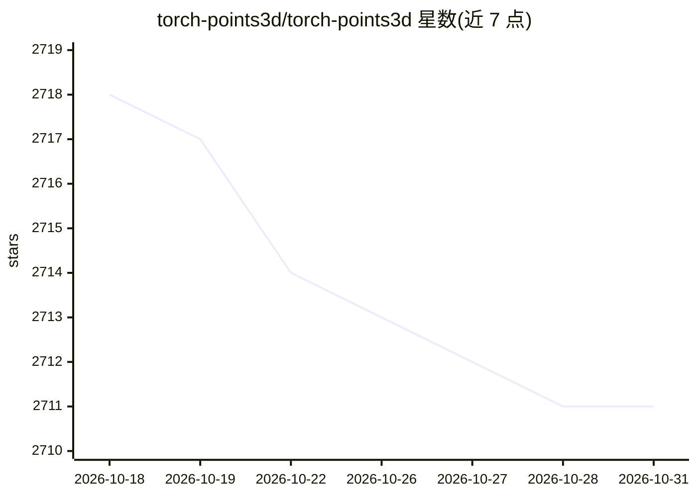

# torch-points3d/torch-points3d

⭐ 2,711 · Python · NOASSERTION · 推送 2026-10-12 · [GitHub](https://github.com/torch-points3d/torch-points3d) · [官网](https://torch-points3d.readthedocs.io/en/latest/) · 组织维护

**面向研究者的点云深度学习 PyTorch 框架**

基于 PyTorch Geometric 与 Facebook Hydra 构建的点云深度学习框架，覆盖分割、分类、目标检测、全景分割与配准五类任务；实现了 PointNet/PointNet++、KPConv、MinkowskiEngine、VoteNet 等 14 种模型，内置 ScanNet、S3DIS、ShapeNet、KITTI 等基准数据集支持。提供高层 API 快速组装模型（如 SparseConv3d），支持 MinkowskiEngine 与 torchsparse 两种稀疏卷积后端、混合精度训练、Wandb 预训练模型注册表与推理部署 Docker 化。主要面向做点云研究与新模型构建的开发者与科研人员。

## 筛选速览

| 维度 | 判定 | 备注 |
|---|---|---|
| AI 角色 | `ai-native` | 本体是模型或模型工具 |
| 许可风险 | `none` | NOASSERTION |
| 部署形态 | `self-host` | docker 或自建部署 |
| 模型依赖 | — | README 未给出锁定关系 |
| 硬件要求 | — | 无带数字的原话,不猜 |
| 安装摩擦 | `low` | 无编译、无系统依赖或容器化 |
| 成熟度 | — | 结构信号不足 |

## 能力要点

- 实现 14 种点云模型（PointNet++、KPConv、RSConv、RandLA-Net、VoteNet 等）
- 支持 MinkowskiEngine / torchsparse 两种稀疏卷积后端
- 覆盖分割/分类/检测/全景分割/配准五类任务的基准数据集
- PretrainedRegistry 两行代码加载预训练权重，推理模型可 Docker 化部署

## 适用场景

- 在 ScanNet、S3DIS 等基准上训练和评测点云模型
- 用高层 API 快速组装 UNet 等稀疏卷积网络
- 将训练好的分割模型打包成 Docker 镜像做批量推理

## 场景标签

`模型训练` `目标检测` · 领域:感知与多模态

## 证据(README 行号)

> L3: This is a framework for running common deep learning models for point cloud analysis tasks against classic benchmark
> L5: The framework allows lean and yet complex model to be built with minimum effort and great reproducibility.
> L6: It also provide a high level API to democratize deep learning on pointclouds.

## 星数曲线

2026-10-18 2,718 → 2026-10-31 2,711（-7）

---
*卡片 v1 · prompt 1.4 · 生成 2026-10-21 · 置信度 high · 依据 README sha `4898c45d4ff8` · [字段定义](../../DATASET.md)*
