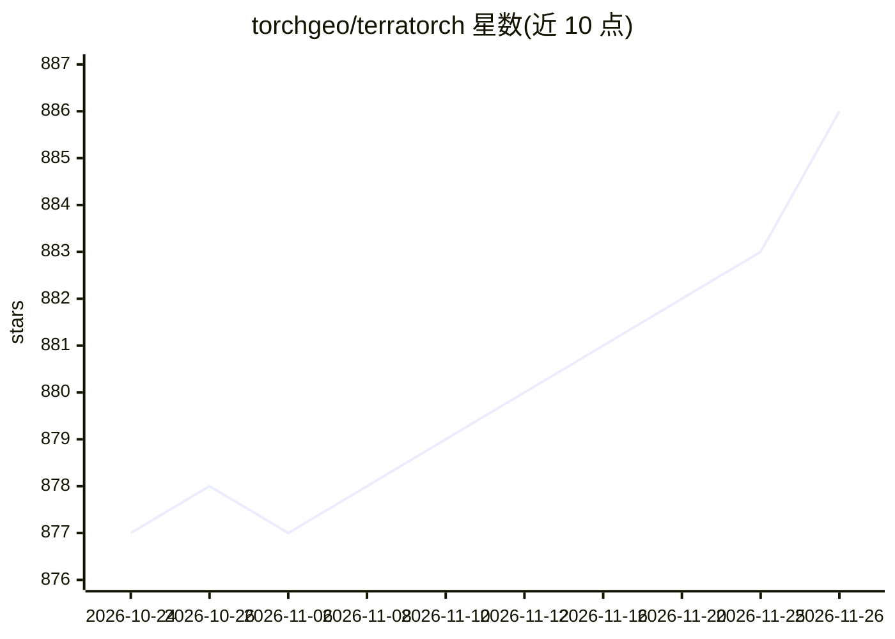

# torchgeo/terratorch

⭐ 886 · Python · Apache-2.0 · 推送 2026-11-25 · [GitHub](https://github.com/torchgeo/terratorch) · [官网](https://torchgeo.github.io/terratorch/) · 组织维护

**地理空间基础模型微调的 Python 工具包**

基于 PyTorch Lightning 与 TorchGeo 构建的领域库，为地理空间基础模型（GFM）提供微调与推理框架。提供分割、分类、像素级回归的灵活训练器，backbone+decoder 组合的模型工厂，开箱即用的 datamodule，以及通过 CLI、配置文件或 Jupyter 启动任务。接入 Prithvi、TerraMind、SatMAE、Clay 等预训练骨干及 timm/SMP 生态。本体不托管模型，模型许可由用户自行核验。需要系统安装 GDAL。

## 筛选速览

| 维度 | 判定 | 备注 |
|---|---|---|
| AI 角色 | `ai-ecosystem` | LLM/agent 周边工具 |
| 许可风险 | `permissive` | Apache-2.0 |
| 部署形态 | `library` | 以包/库形式分发 |
| 模型依赖 | local-ok | 支持本地模型 |
| 硬件要求 | — | 无带数字的原话,不猜 |
| 安装摩擦 | `high` | 编译与系统依赖俱全 |
| 成熟度 | — | 结构信号不足 |

## 能力要点

- 图像分割、分类与像素级回归的微调训练器
- 模型工厂组合 backbone 与 decoder，CLI/配置文件/Jupyter 启动任务
- 接入 Prithvi、TerraMind、SatMAE、Clay 等开源 GFM 骨干与 GEO-Bench 数据集
- pip/conda/pipx 多渠道安装，支持 vllm、PEFT 等可选扩展

## 适用场景

- 用预训练地理空间基础模型微调卫星影像分割/分类任务
- 无需自定义 Dataset 类即可接入自有地理空间数据
- 在 CLI 或 notebook 中运行地理空间模型推理

## 场景标签

`微调` `目标检测` · 领域:感知与多模态

## 证据(README 行号)

> L15: TerraTorch is a PyTorch domain library based on PyTorch Lightning and the TorchGeo domain library
> L21: TerraTorch provides tools for fine-tuning and using pretrained models.
> L35: TerraTorch’s main purpose is to provide a flexible fine-tuning framework for Geospatial Foundation Models, which ca

## 星数曲线

2026-10-24 877 → 2026-11-26 886（+9）

---
*卡片 v1 · prompt 1.4 · 生成 2026-11-24 · 置信度 high · 依据 README sha `8fc17a81b999` · [字段定义](../../DATASET.md)*
