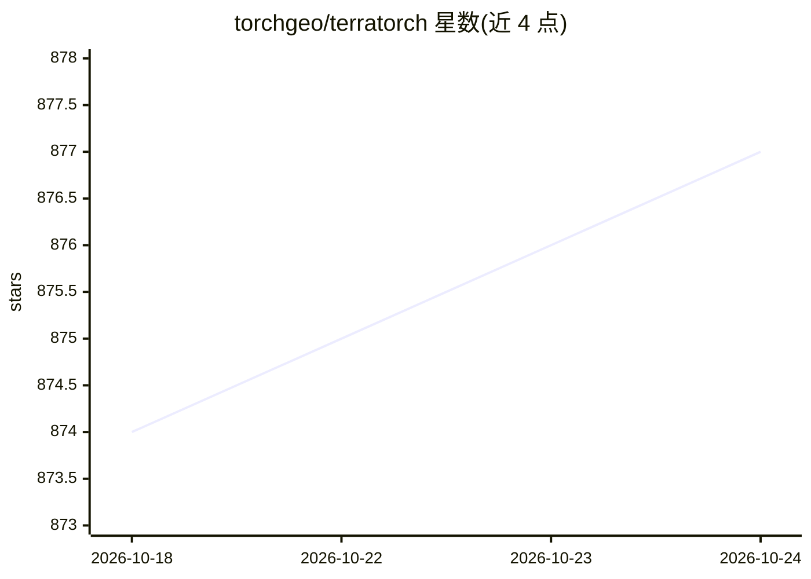

# torchgeo/terratorch

⭐ 877 · Python · Apache-2.0 · 推送 2026-10-22 · [GitHub](https://github.com/torchgeo/terratorch) · [官网](https://torchgeo.github.io/terratorch/) · 组织维护

**地理空间基础模型（GFM）微调框架，面向遥感/地球观测开发者**

基于 PyTorch Lightning 与 TorchGeo 的 Python 领域库，提供图像分割、分类与像素级回归的微调训练器、骨干与解码器组合的模型工厂、即用数据集模块，以及通过 CLI/配置文件或 Jupyter 启动任务的接口。支持访问 Prithvi、TerraMind、SatMAE、Clay 等开源预训练 GFM 骨干及 GEO-Bench/TorchGeo 数据集。自身不托管模型，仅提供训练与推理框架；运行需 GDAL，可选支持 vLLM、PEFT、天气基础模型等扩展。

## 筛选速览

| 维度 | 判定 | 备注 |
|---|---|---|
| AI 角色 | `ai-ecosystem` | LLM/agent 周边工具 |
| 许可风险 | `permissive` | Apache-2.0 |
| 部署形态 | `library` | 以包/库形式分发 |
| 模型依赖 | local-ok | 支持本地模型 |
| 硬件要求 | — | 无带数字的原话,不猜 |
| 安装摩擦 | `high` | 编译与系统依赖俱全 |
| 成熟度 | — | 结构信号不足 |

## 能力要点

- 图像分割/分类/像素级回归的灵活微调训练器
- 模型工厂组合 GFM 骨干（Prithvi、TerraMind、Clay 等）与 SMP/mmsegmentation 解码器
- CLI + 配置文件或 Jupyter 启动微调任务
- 可选扩展：vLLM、PEFT、天气基础模型（wxc）、RF-DETR 等

## 适用场景

- 微调开源地理空间基础模型完成遥感分割或分类任务
- 复用 GEO-Bench / TorchGeo 数据集快速搭建训练流程
- 通过参数高效微调（PEFT）在自有地理数据上适配预训练骨干

## 场景标签

 · 领域:地球观测/地理空间深度学习

## 证据(README 行号)

> L15: TerraTorch is a PyTorch domain library based on PyTorch Lightning and the TorchGeo domain library
> L21: TerraTorch provides tools for fine-tuning and using pretrained models.
> L35: TerraTorch’s main purpose is to provide a flexible fine-tuning framework for Geospatial Foundation Models, which ca

## 星数曲线

2026-10-18 874 → 2026-10-24 877（+3）

---
*卡片 v1 · prompt 1.4 · 生成 2026-10-21 · 置信度 high · 依据 README sha `41ed011de66f` · [字段定义](../../DATASET.md)*
