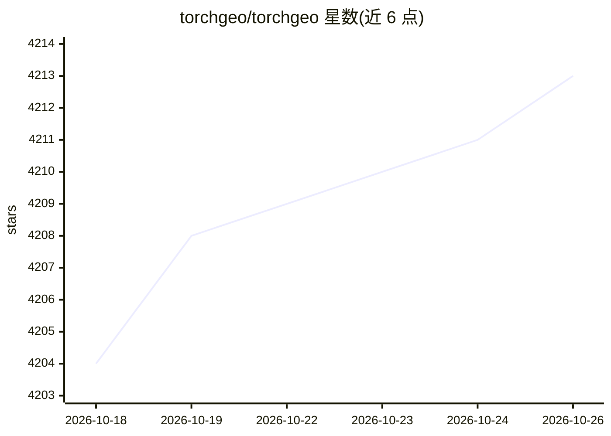

# torchgeo/torchgeo

⭐ 4,213 · Python · MIT · 推送 2026-10-24 · [GitHub](https://github.com/torchgeo/torchgeo) · [官网](https://torchgeo.org/) · 组织维护

**面向地理空间数据的 PyTorch 领域库：数据集、采样器、变换与预训练模型**

类似 torchvision 的 PyTorch 领域库，为遥感与地理空间数据提供基准/地理空间数据集、按地理坐标采样小图块的采样器、变换，以及在多光谱影像上预训练的模型权重，采用 torchvision 的多权重 API。支持数据集并集/交集组合、自动 CRS 与分辨率对齐、基于 Lightning 的 datamodule 与任务（分类/回归/语义分割等），并提供 torchgeo 命令行训练接口。面向希望处理地理空间数据的机器学习专家与希望探索机器学习方案的遥感专家。

## 筛选速览

| 维度 | 判定 | 备注 |
|---|---|---|
| AI 角色 | `ai-ecosystem` | LLM/agent 周边工具 |
| 许可风险 | `permissive` | MIT |
| 部署形态 | `library` | 以包/库形式分发 |
| 模型依赖 | — | README 未给出锁定关系 |
| 硬件要求 | — | 无带数字的原话,不猜 |
| 安装摩擦 | `low` | 无编译、无系统依赖或容器化 |
| 成熟度 | — | 结构信号不足 |

## 能力要点

- 地理空间数据集的交集/并集组合与自动 CRS/分辨率对齐
- 按地理坐标采样大图的 RandomPatchSampler 等采样器
- 支持多光谱传感器预训练权重，采用 torchvision 多权重 API
- Lightning datamodule 与 LightningCLI 命令行训练（torchgeo fit/validate/test）

## 适用场景

- 用 Landsat/CDL 组合数据采样训练或预测
- 语义分割、目标检测等遥感任务使用预训练权重做迁移学习
- 用统一接口复现文献中的遥感基准实验

## 场景标签

 · 领域:地球观测/遥感深度学习

## 证据(README 行号)

> L3: TorchGeo is a PyTorch domain library, similar to torchvision, providing datasets, samplers, transforms, and pre-trai
> L5: The goal of this library is to make it simple:
> L7: 1. for machine learning experts to work with geospatial data, and

## 星数曲线

2026-10-18 4,204 → 2026-10-26 4,213（+9）

---
*卡片 v1 · prompt 1.4 · 生成 2026-10-20 · 置信度 high · 依据 README sha `9a88d8e352de` · [字段定义](../../DATASET.md)*
