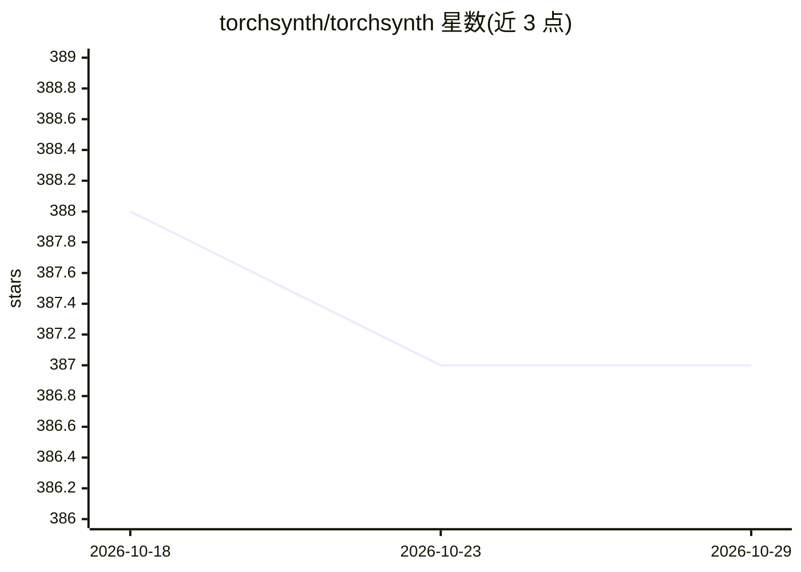

# torchsynth/torchsynth

⭐ 387 · Python · Apache-2.0 · 推送 2026-02-16 · [GitHub](https://github.com/torchsynth/torchsynth) · [官网](https://torchsynth.rtfd.io/) · 组织维护

**给音频 ML 研究者的 PyTorch 模块化合成器，GPU 可选、可微分**

基于传统模块化合成原理、用 PyTorch 实现的合成器库。GPU 为可选配置，合成过程可微分；在单 GPU 上吞吐速度为实时的 16200 倍，面向需要大规模训练语料的音频 ML 研究者。所有生成的音频均返回对应的隐参数，可用于多模态训练。依赖 PyTorch 1.8 及以上版本，通过 pip 从 PyPI 安装；附 Colab 示例与已渲染的 synth1K1 数据集，有对应论文可引用。

## 筛选速览

| 维度 | 判定 | 备注 |
|---|---|---|
| AI 角色 | `ai-native` | 本体是模型或模型工具 |
| 许可风险 | `permissive` | Apache-2.0 |
| 部署形态 | `library` | 以包/库形式分发 |
| 模型依赖 | — | README 未给出锁定关系 |
| 硬件要求 | — | 无带数字的原话,不猜 |
| 安装摩擦 | `low` | 无编译、无系统依赖或容器化 |
| 成熟度 | — | 结构信号不足 |

## 能力要点

- 用 PyTorch 实现的模块化合成器，可微分、GPU 可选
- 单 GPU 吞吐为实时 16200 倍（714MHz）
- 合成音频附带对应的隐参数，适用于多模态训练

## 适用场景

- 为音频 ML 研究批量生成大规模训练语料
- 获得音频与隐参数配对数据用于多模态训练
- 通过 Colab 试听并了解合成效果

## 场景标签

 · 领域:音频机器学习/合成器

## 证据(README 行号)

> L7: torchsynth is based upon traditional modular synthesis written in
> L12: realtime (714MHz) on a single GPU. This is of particular interest
> L13: to audio ML researchers seeking large training corpora.

## 星数曲线

2026-10-18 388 → 2026-10-29 387（-1）

---
*卡片 v1 · prompt 1.4 · 生成 2026-10-21 · 置信度 high · 依据 README sha `739f405f2f2b` · [字段定义](../../DATASET.md)*
