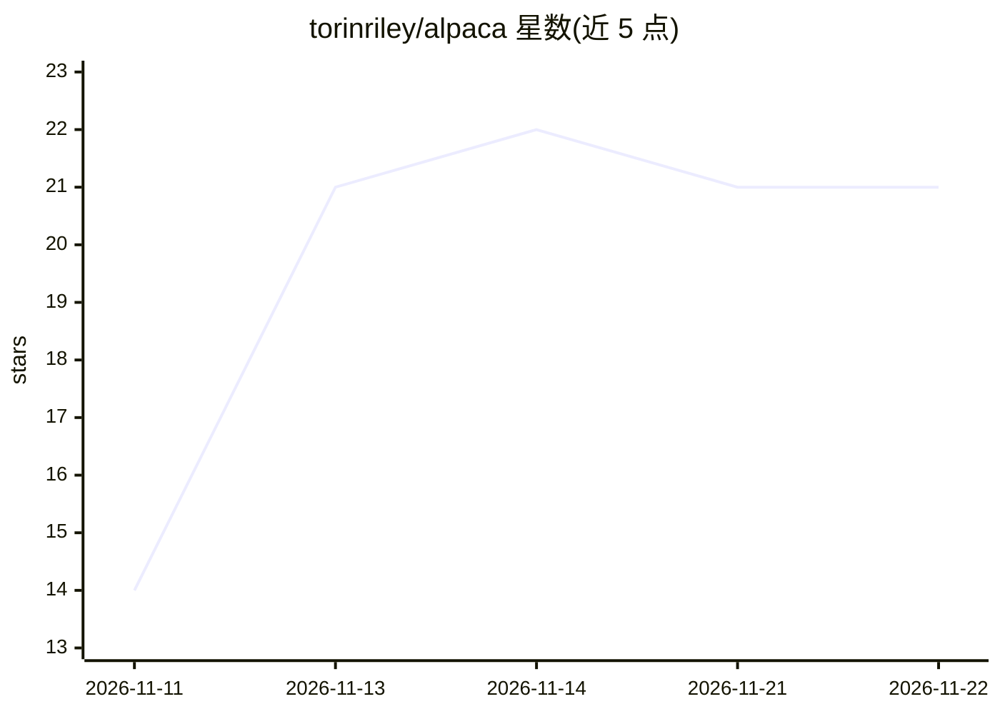

# torinriley/alpaca

⭐ 21 · Swift · MIT · 推送 2026-11-17 · [GitHub](https://github.com/torinriley/alpaca) · [官网](https://torinriley.github.io/alpaca-site) · 个人维护

**Apple Silicon 上的 Swift 原生 LLM 推理引擎（Metal 自研内核）**

从零用 Swift 实现的 LLM 推理引擎，张量引擎、GGUF 解析、BPE 分词器、Llama 前向与 Metal 内核均为本仓库自研，运行时不依赖 llama.cpp/MLX/Core ML/Python。支持 Llama 式解码器与 F16/Q8_0/Q4_0 权重，提供 Swift 库、CLI（generate/bench/profile）与 SwiftUI 参考应用。限制：版本 0.2.0-pre，最快路径需 Apple10 家族 GPU（M5/A19），尚未在物理 iPhone/iPad 上运行（仅 iOS 模拟器编译），基准仅在一台 Apple M5 上测量。

## 筛选速览

| 维度 | 判定 | 备注 |
|---|---|---|
| AI 角色 | `ai-ecosystem` | LLM/agent 周边工具 |
| 许可风险 | `permissive` | MIT |
| 部署形态 | `None` |  |
| 模型依赖 | — | README 未给出锁定关系 |
| 硬件要求 | — | 无带数字的原话,不猜 |
| 安装摩擦 | `low` | 无编译、无系统依赖或容器化 |
| 成熟度 | `idea` | |

## 能力要点

- 自研张量引擎、GGUF 解析、BPE 分词器与 Metal 内核，运行时零外部推理依赖
- GGUF 权重内存映射、无拷贝 MTLBuffer，常驻内存约等于文件大小
- GGUF 解析器按不可信输入处理，长度有界、算术溢出检查，通过 2 万个变异模糊文件
- async 加载、AsyncSequence 流式输出、取消、种子采样与内存预算检查

## 适用场景

- 在 macOS/iOS 应用中以 Swift 库形式本地运行 GGUF 模型
- 用 CLI 在 Apple Silicon 上做 GGUF 模型推理与基准测试
- 参考 SwiftUI 示例应用构建带流式输出的本地推理界面

## 场景标签

`推理引擎` · 领域:训练与推理

## 证据(README 行号)

> L10: A from-scratch Swift inference engine with custom Metal kernels — no llama.cpp, MLX, Core ML, ONNX, or Python at ru
> L99: |Platforms|macOS 14+, iOS 17+, Apple Silicon (arm64). Swift 6 language mode; developed with Swift 6.4 / Xcode 27|

## 星数曲线

2026-11-11 14 → 2026-11-22 21（+7）

---
*卡片 v1 · prompt 1.4 · 生成 2026-11-18 · 置信度 high · 依据 README sha `17c5ecd0ac30` · [字段定义](../../DATASET.md)*
