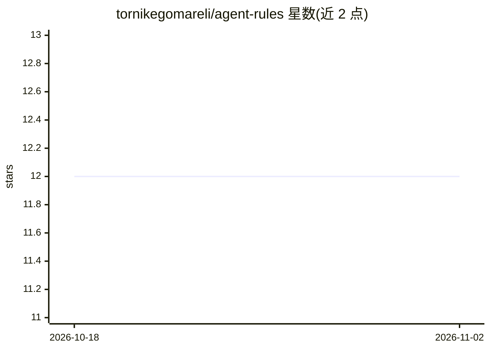

# tornikegomareli/agent-rules

⭐ 12 · Python · MIT · 推送 2026-07-30 · [GitHub](https://github.com/tornikegomareli/agent-rules) · 个人维护

**为所有本机编码 agent 统一注入行为规则集的工具**

面向使用多种编码 agent（Claude Code、Codex CLI、Gemini CLI 等）的开发者：通过 install.sh 将一份约 300 行的 RULES.md 写入各 agent 的全局记忆文件（CLAUDE.md/AGENTS.md/GEMINI.md 等），约束回答结构、长度、句式、词汇、平实技术英语（基于 ASD-STE100）、反谄媚与不确定性表述等。另提供可按需调用的 skill 模式与 Claude Code 插件形式，附带基于正则打分的基准测试。README 同时说明代价：tokens 成本上升、宽泛解释类问题会损失信息覆盖。

## 筛选速览

| 维度 | 判定 | 备注 |
|---|---|---|
| AI 角色 | `ai-ecosystem` | LLM/agent 周边工具 |
| 许可风险 | `permissive` | MIT |
| 部署形态 | `library` | 以包/库形式分发 |
| 模型依赖 | — | README 未给出锁定关系 |
| 硬件要求 | — | 无带数字的原话,不猜 |
| 安装摩擦 | `low` | 无编译、无系统依赖或容器化 |
| 成熟度 | — | 结构信号不足 |

## 能力要点

- install.sh 自动发现并写入 6 种编码 agent 的全局记忆文件，支持 --path 扩展任意文件
- 规则覆盖回答结构、19 种句式模式、禁用词表、ASD-STE100 平实技术英语等 14 个方面
- merge/replace 两种安装模式均可逆（--uninstall/--restore），备份不覆盖
- 附带可复现基准：正则打分 + 盲测双轮评判，公布胜负与失败案例

## 适用场景

- 我有多个编码 agent，想用一份规则统一它们的输出风格
- 去除 agent 生成文本中的套话、营销腔与编造内容
- 对已有 README 或发布说明按规则检查并清理（skill 模式）

## 场景标签

`提示工程` · 领域:Agent 开发

## 证据(README 行号)

> L10: `install.sh` writes it into each agent's global memory file, so it applies in
> L26: |Agent|File|
> L104: Same prompt, same model. The only difference is whether `RULES.md` was loaded.

## 星数曲线

2026-10-18 12 → 2026-11-02 12（+0）

---
*卡片 v1 · prompt 1.4 · 生成 2026-10-31 · 置信度 high · 依据 README sha `f11592e82927` · [字段定义](../../DATASET.md)*
