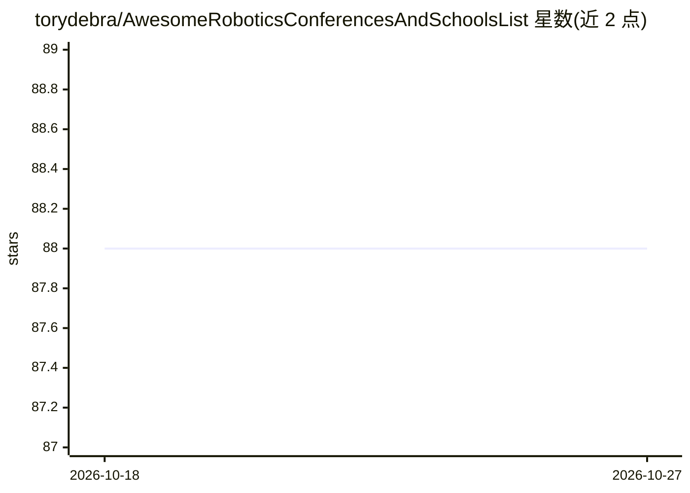

# torydebra/AwesomeRoboticsConferencesAndSchoolsList

⭐ 88 · JavaScript · GPL-3.0 · 推送 2026-10-25 · [GitHub](https://github.com/torydebra/AwesomeRoboticsConferencesAndSchoolsList) · [官网](https://torydebra.github.io/AwesomeRoboticsConferencesAndSchoolsList/) · 个人维护

**机器人学术会议与暑期学校清单：交互式表格选会**

面向机器人研究者的会议与学校聚合清单，以 GitHub Pages 上的交互式表格呈现条目。数据来源包括 Robotics worldwide 邮件列表、EuRobotics 邮件列表、通过抓取 IEEE RAS 官网获取的会议信息、awesome-mlss 及社交媒体与人工贡献。仓库通过 GitHub Actions 自动抓取并验证 JSON 数据，由社区以 PR 方式贡献更新；作者声明信息可能滞后，提醒用户以官方会议网站为准。

## 筛选速览

| 维度 | 判定 | 备注 |
|---|---|---|
| AI 角色 | `ai-knowledge` | 知识聚合/清单类 |
| 许可风险 | `viral` | GPL-3.0 |
| 部署形态 | `None` |  |
| 模型依赖 | — | README 未给出锁定关系 |
| 硬件要求 | — | 无带数字的原话,不猜 |
| 安装摩擦 | `low` | 无编译、无系统依赖或容器化 |
| 成熟度 | — | 结构信号不足 |

## 能力要点

- 交互式表格在 GitHub Pages 在线浏览
- 自动抓取 IEEE RAS 即将召开的会议
- GitHub Actions 校验 JSON 并自动化维护流程
- 社区通过 PR/issue 贡献更新

## 适用场景

- 寻找下一个可投稿或参加的机器人会议
- 查找机器人与机器学习相关的暑期学校
- 跟踪即将召开的 IEEE RAS 会议信息

## 场景标签

`精选清单` · 领域:学习与行业

## 证据(README 行号)

> L8: The list is live at https://torydebra.github.io/AwesomeRoboticsConferencesAndSchoolsList
> L25: - IEEE RAS upcoming conferences, by scraping it :D

## 星数曲线

2026-10-18 88 → 2026-10-27 88（+0）

---
*卡片 v1 · prompt 1.4 · 生成 2026-10-23 · 置信度 high · 依据 README sha `25f06454153d` · [字段定义](../../DATASET.md)*
