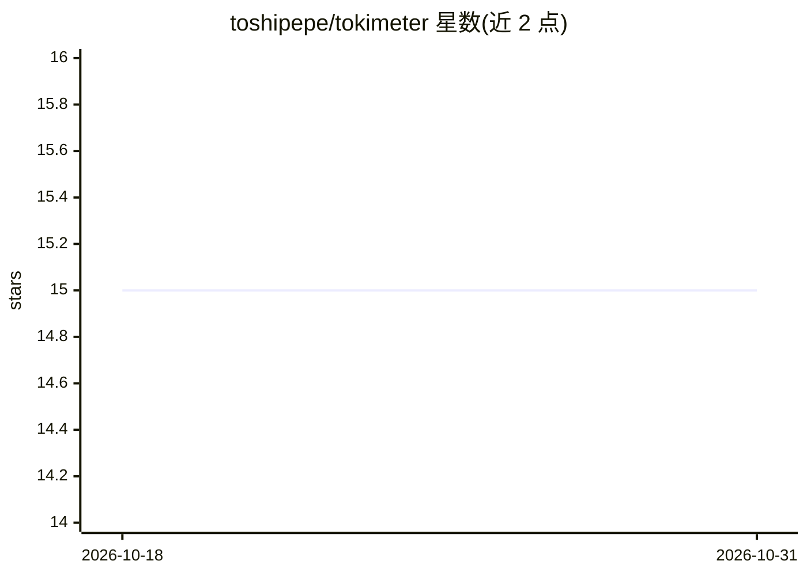

# toshipepe/tokimeter

⭐ 15 · JavaScript · MIT · 推送 2026-09-17 · [GitHub](https://github.com/toshipepe/tokimeter) · [官网](https://tokimeter.com) · 个人维护

**本地优先的 AI 编程助手用量与成本计量工具**

面向使用 Claude Code、Codex、Cursor、Grok Build、Goose、Hermes、opencode、Cline、Copilot CLI 等多种 AI 编程助手的开发者，读取各工具已存在的本地用量元数据（日志、数据库、账本），汇总为一份报告：总花费、调用数、token 数、缓存节省、API 等效成本。支持设置 5 小时/7 天/会话级预算与告警、在 Claude Code 与 Codex 状态栏内显示 HUD、生成 LiteLLM/OpenRouter 格式的路由策略。不读取提示词内容、不调用模型、无需账号或 API key；可选连接托管仪表板。以 npm/npx 分发，需 Node.js 18+。部分集成标注为 fixture tested 而非 live verified。

## 筛选速览

| 维度 | 判定 | 备注 |
|---|---|---|
| AI 角色 | `ai-ecosystem` | LLM/agent 周边工具 |
| 许可风险 | `permissive` | MIT |
| 部署形态 | `library` | 以包/库形式分发 |
| 模型依赖 | — | README 未给出锁定关系 |
| 硬件要求 | — | 无带数字的原话,不猜 |
| 安装摩擦 | `low` | 无编译、无系统依赖或容器化 |
| 成熟度 | — | 结构信号不足 |

## 能力要点

- 一份报告聚合多种 AI 编程助手的本地用量元数据
- 5h/7d/会话预算与状态栏 HUD 告警（仅告警，不拦截）
- 不读取提示词、不调用模型、无需账号或遥测
- 可输出 LiteLLM/OpenRouter 格式的路由策略

## 适用场景

- 我想看清自己本月在各 AI 编程工具上花了多少钱
- 临近额度上限时在工作流内收到告警
- 对比不同 agent/技能的花费分布并寻找节省空间

## 场景标签

`LLM 可观测性` · 领域:评测与运维

## 证据(README 行号)

> L5: **Local-first usage and cost meter for Claude Code, Codex, Cursor, Grok Build,
> L40: Tokimeter reads usage metadata, not your prompts or responses. Local features
> L144: Tokimeter adds live per-call usage accounting, budgets, a local watch feed, and a

## 星数曲线

2026-10-18 15 → 2026-10-31 15（+0）

---
*卡片 v1 · prompt 1.4 · 生成 2026-10-30 · 置信度 high · 依据 README sha `9dc2b29bba30` · [字段定义](../../DATASET.md)*
