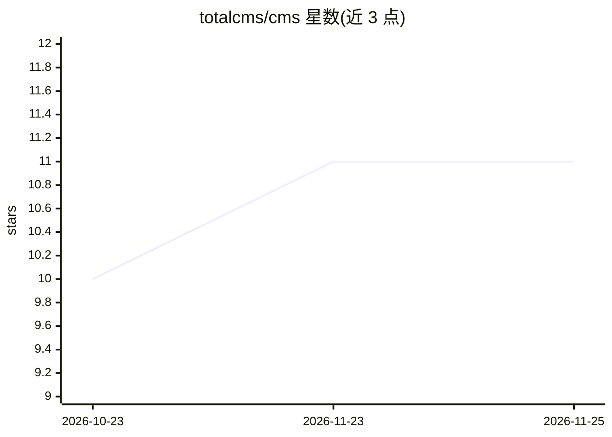

# totalcms/cms

⭐ 11 · PHP · NOASSERTION · 推送 2026-11-23 · [GitHub](https://github.com/totalcms/cms) · [官网](https://totalcms.co) · 组织维护

**面向 Web 专业者的无数据库 flat-file PHP CMS，内置 MCP 供 AI agent 操作**

基于 PHP 8.2+ 与 Slim 4 的内容管理系统，内容以 JSON 文件存储在磁盘，无需 MySQL。提供 33 种内置集合类型与自定义 schema、Twig 3 模板（含 89 个自定义过滤器）、完整 CRUD 的 REST API（API-key 或 OAuth 2.1）、tcms CLI、定时/webhook 自动化任务队列，以及表单式管理后台。AI 相关：内置 MCP 服务器（Pro 版）将站点集合与搜索暴露给 agent，文档提供 llms.txt，composer install 时自动安装 agent skill 到 .claude/skills。为商业软件，生产使用需购买许可。

## 筛选速览

| 维度 | 判定 | 备注 |
|---|---|---|
| AI 角色 | `ai-enhanced` | 去掉 AI 部分产品仍成立 |
| 许可风险 | `none` | NOASSERTION |
| 部署形态 | `None` |  |
| 模型依赖 | — | README 未给出锁定关系 |
| 硬件要求 | — | 无带数字的原话,不猜 |
| 安装摩擦 | `low` | 无编译、无系统依赖或容器化 |
| 成熟度 | — | 结构信号不足 |

## 能力要点

- 内容以 JSON 文件存储，无数据库，可随代码版本控制与部署
- 内置 MCP 服务器（Pro 版）暴露集合与搜索给 AI agent
- REST API 全 CRUD，支持 API-key 与 OAuth 2.1 认证
- tcms CLI 覆盖导入/导出、同步与部署

## 适用场景

- 为客户网站搭建结构化内容管理与后台
- 以 headless 方式通过 REST API 消费内容
- 让 AI coding agent 通过 MCP 直接操作在线站点内容

## 场景标签

 · 领域:内容管理系统/Web 开发

## 证据(README 行号)

> L16: Total CMS is a content management system built on PHP 8.2+ and Slim 4 that stores content as
> L29: - **Built-in MCP server** &mdash; exposes your site's collections and search to AI agents (Pro)

## 星数曲线

2026-10-23 10 → 2026-11-25 11（+1）

---
*卡片 v1 · prompt 1.4 · 生成 2026-11-19 · 置信度 high · 依据 README sha `becbc9491b00` · [字段定义](../../DATASET.md)*
