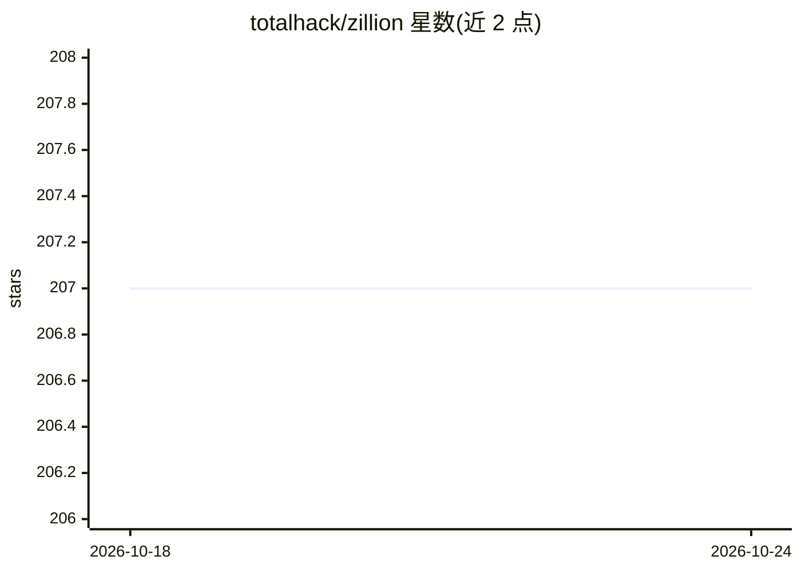

# totalhack/zillion

⭐ 207 · Python · MIT · 推送 2026-10-07 · [GitHub](https://github.com/totalhack/zillion) · 个人维护

**数据建模与分析的语义层工具，含自然语言问答**

Python 数据建模与分析工具：在多个 SQL/文件类数据源之上构建语义层，定义或反射指标、维度与关系，自动生成 SQL 并执行跨数据源报告，结果以 Pandas DataFrame 返回；支持多级汇总、透视、公式、滚动/累计/排名等技术变换，以及从 CSV/XLSX/JSON/Google Sheet 快速建仓。附带 agentic 自然语言问答工作流（plan_question/answer_question），需安装 agent extra 并配置 OpenAI API key，默认模型 gpt-5.4。通过 SQLAlchemy Core 接入现有数据库，项目自称处于 alpha 阶段。

## 筛选速览

| 维度 | 判定 | 备注 |
|---|---|---|
| AI 角色 | `ai-enhanced` | 去掉 AI 部分产品仍成立 |
| 许可风险 | `permissive` | MIT |
| 部署形态 | `library` | 以包/库形式分发 |
| 模型依赖 | — | README 未给出锁定关系 |
| 硬件要求 | — | 无带数字的原话,不猜 |
| 安装摩擦 | `low` | 无编译、无系统依赖或容器化 |
| 成熟度 | `idea` | |

## 能力要点

- 多数据源语义层，自动生成 SQL 并合并结果为 DataFrame
- 自然语言规划与执行报告的 agentic 问答工作流
- 支持多级 rollup、透视、公式与滚动/累计/排名等技术变换
- 可从 CSV/XLSX/JSON/HTML/Google Sheet 一行代码建仓

## 适用场景

- 在多个数据库与文件数据源上统一定义指标维度并出报表
- 用自然语言提问让工具规划并执行分析报告
- 快速对单个 CSV/表格做即席分析

## 场景标签

`数据分析` · 领域:效率与自动化

## 证据(README 行号)

> L11: `Zillion` is a data modeling and analytics tool that allows combining and
> L15: question-answering workflow for planning and executing one or more reports from
> L182: The agentic question workflow requires the `agent` extra and an OpenAI API key.

## 星数曲线

2026-10-18 207 → 2026-10-24 207（+0）

---
*卡片 v1 · prompt 1.4 · 生成 2026-10-22 · 置信度 high · 依据 README sha `72eb0ea8719f` · [字段定义](../../DATASET.md)*
