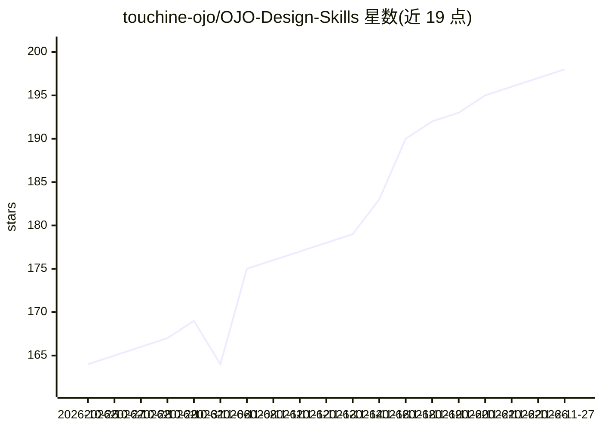

# touchine-ojo/OJO-Design-Skills

⭐ 198 · Shell · MIT · 推送 2026-11-01 · [GitHub](https://github.com/touchine-ojo/OJO-Design-Skills) · [官网](https://ojo.art) · 组织维护 · 中文 README

**为 AI 编码 agent 安装的可复用 UI/UX 设计技能包**

以技能包形式为 AI 编码 agent 提供 UI/UX 设计方法论：双轨制（面向 SaaS 的 Convention Track、品牌驱动的 Innovation Track）、设计 tokens、组件配方、动效规格与反 AI 风格化的硬性规则。通过单个 shell 安装脚本写入各客户端的 skills 目录，支持 Codex、Claude Code、ZCode、DeepCode、WorkBuddy、OpenCode 及通用 agent；支持强制覆盖、自定义目录、钉定版本、--dry-run 预览与按单个技能安装。安装后 agent 检测到设计相关意图时自动激活。MIT 许可，提供 Bash+curl+tar 安装。

## 筛选速览

| 维度 | 判定 | 备注 |
|---|---|---|
| AI 角色 | `ai-ecosystem` | LLM/agent 周边工具 |
| 许可风险 | `permissive` | MIT |
| 部署形态 | `None` |  |
| 模型依赖 | — | README 未给出锁定关系 |
| 硬件要求 | — | 无带数字的原话,不猜 |
| 安装摩擦 | `low` | 无编译、无系统依赖或容器化 |
| 成熟度 | — | 结构信号不足 |

## 能力要点

- 双轨方法论：Convention Track 沿用成熟设计语言，Innovation Track 品牌驱动
- 反 AI 风格硬性规则（禁紫蓝渐变、灰盒占位等）与真实图片素材要求
- 单脚本安装器支持 7 类客户端目标，支持钉定 tag/commit 复现安装
- 产出技能前强制进行 2–3 个方向的风格确认门槛

## 适用场景

- 给 Claude Code / Codex 等 agent 装上设计系统方法论
- 让同一产品在落地页、仪表盘等多表面保持一致视觉
- 约束 agent 生成的界面不落入通用 AI 风格

## 场景标签

`提示工程` `代码生成` · 领域:Agent 开发

## 证据(README 行号)

> L13: OJO Design Skills is a drop-in skill bundle that teaches your AI coding agent how to make real design decisions — n
> L15: It is agent-agnostic and ships with a single installer that targets every major client.
> L50: curl -fsSL https://raw.githubusercontent.com/touchine-ojo/OJO-Design-Skills/main/scripts/install.sh | bash -s -- --

## 星数曲线

2026-10-25 164 → 2026-11-27 198（+34）

---
*卡片 v1 · prompt 1.4 · 生成 2026-11-25 · 置信度 high · 依据 README sha `2b60aae18b1b` · [字段定义](../../DATASET.md)*
