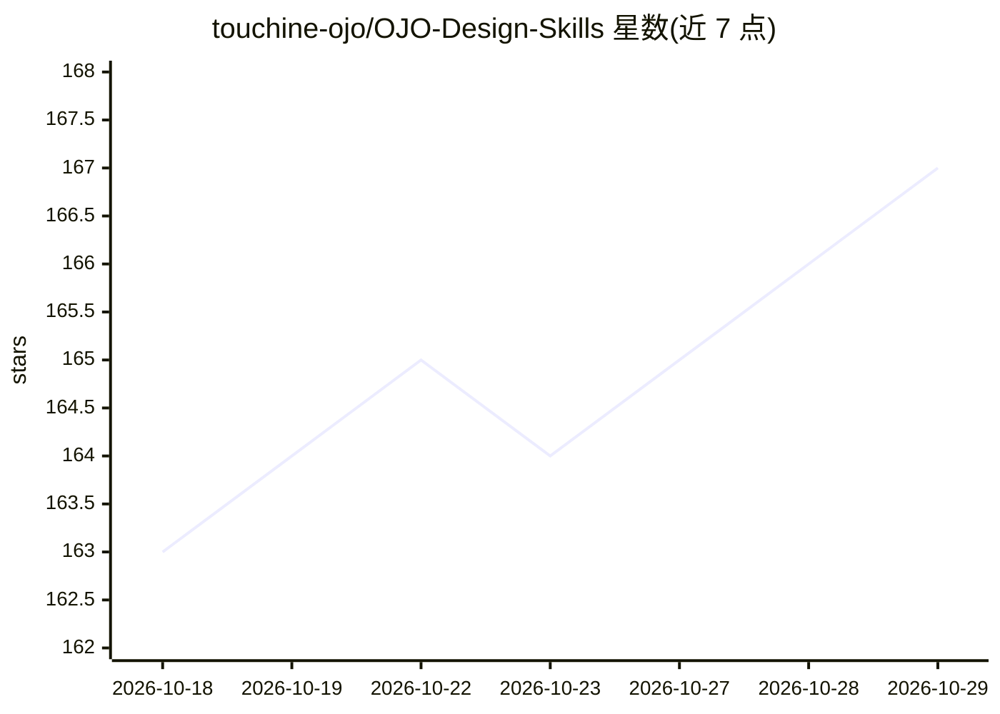

# touchine-ojo/OJO-Design-Skills

⭐ 167 · Shell · MIT · 推送 2026-07-29 · [GitHub](https://github.com/touchine-ojo/OJO-Design-Skills) · [官网](https://ojo.art) · 组织维护 · 中文 README

**给 AI 编码 agent 的可复用 UI/UX 设计技能包**

面向 Codex、Claude Code、ZCode 等 AI 编码 agent 的即装技能包，为 agent 注入一套 UI/UX 设计方法：双轨方法论（Convention Track 采用成熟设计语言，Innovation Track 构建品牌驱动视觉方向）、反 AI 味护栏（硬性禁用紫蓝渐变等组合）、真实图片要求、输出原子化 Tailwind 类字符串与 8 态交互模型。提供单一 Bash 安装脚本，支持 7 类客户端目标目录、指定标签安装、dry-run 与单技能安装，技能在 agent 检测到设计意图时自动激活。

## 筛选速览

| 维度 | 判定 | 备注 |
|---|---|---|
| AI 角色 | `ai-knowledge` | 知识聚合/清单类 |
| 许可风险 | `permissive` | MIT |
| 部署形态 | `None` |  |
| 模型依赖 | — | README 未给出锁定关系 |
| 硬件要求 | — | 无带数字的原话,不猜 |
| 安装摩擦 | `low` | 无编译、无系统依赖或容器化 |
| 成熟度 | — | 结构信号不足 |

## 能力要点

- 双轨设计方法论：成熟设计语言采纳与品牌驱动创新两轨
- 反 AI 味硬性护栏与真实图片要求
- 组件解析为原子 Tailwind 类字符串，含 8 态交互模型
- 单一安装脚本覆盖 7 类 agent 客户端，支持 dry-run/单技能/固定版本安装

## 适用场景

- 让 AI 编码 agent 生成有设计决策依据的界面而非通用 AI 风格布局
- 为 SaaS/工具类产品快速套用成熟设计语言并产出设计规范
- 为品牌类产品构建有品牌辨识度的视觉方向

## 场景标签

`提示工程` · 领域:Agent 开发

## 证据(README 行号)

> L3: **Reusable UI/UX design skills for AI coding agents — Codex, Claude Code, ZCode, and more.**
> L13: OJO Design Skills is a drop-in skill bundle that teaches your AI coding agent how to make real design decisions — n
> L15: It is agent-agnostic and ships with a single installer that targets every major client.

## 星数曲线

2026-10-18 163 → 2026-10-29 167（+4）

---
*卡片 v1 · prompt 1.4 · 生成 2026-10-22 · 置信度 high · 依据 README sha `49a510047c60` · [字段定义](../../DATASET.md)*
