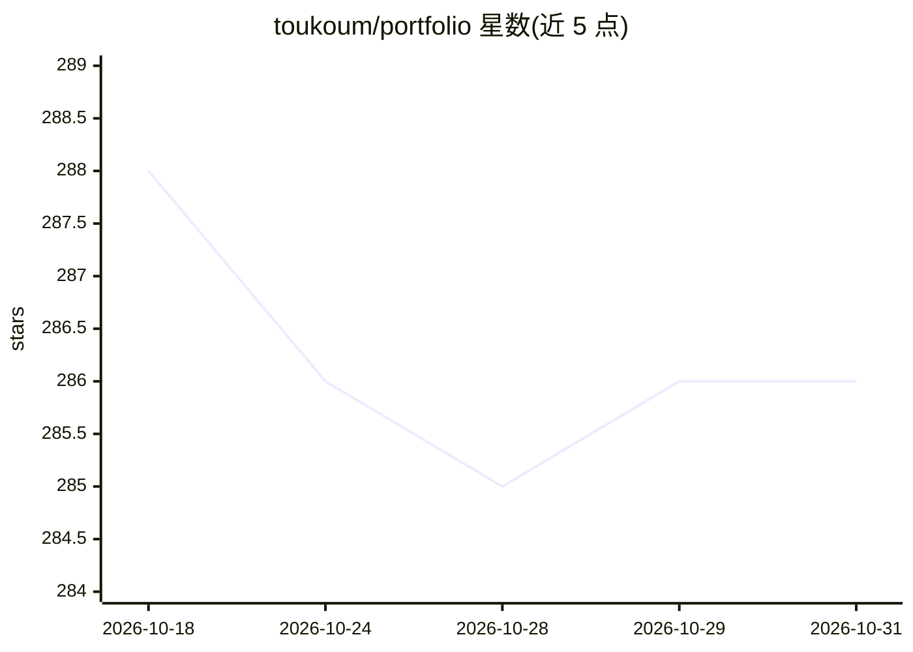

# toukoum/portfolio

⭐ 286 · TypeScript · 推送 2026-02-03 · [GitHub](https://github.com/toukoum/portfolio) · [官网](https://toukoum.fr) · 个人维护

**对话式 AI 个人作品集：访客提问，AI 头像即时回答**

一个个人作品集网站（toukoum.fr），以对话替代传统滚动浏览：访客提问，AI 头像即时回答，面向招聘者、开发者、亲友三类访客。技术栈基于 Node.js 与 pnpm，运行需 OpenAI API key（AI 聊天）与 GitHub token（GitHub 集成功能）。通过 git clone 源码加 pnpm 安装依赖后以开发服务器本地运行。README 未披露模型选择、回答生成机制细节或其他功能模块。

## 筛选速览

| 维度 | 判定 | 备注 |
|---|---|---|
| AI 角色 | `ai-native` | 本体是模型或模型工具 |
| 许可风险 | `none` | — |
| 部署形态 | `library` | 以包/库形式分发 |
| 模型依赖 | — | README 未给出锁定关系 |
| 硬件要求 | — | 无带数字的原话,不猜 |
| 安装摩擦 | `low` | 无编译、无系统依赖或容器化 |
| 成熟度 | — | 结构信号不足 |

## 能力要点

- 以 AI 对话替代静态滚动式作品集页面
- 按访客身份（招聘者/开发者/亲友）定制回答内容
- 集成 GitHub 数据（需 GitHub token）

## 适用场景

- 招聘者通过提问快速了解候选人的技术栈与成果
- 开发者了解作者的代码与思维方式
- 亲友询问作者近期在做的事

## 场景标签

`聊天机器人` · 领域:对话与助手

## 证据(README 行号)

> L8: Instead of making you scroll endlessly, my portfolio adapts to *you*.
> L9: Ask a question — my AI avatar replies instantly.

## 星数曲线

2026-10-18 288 → 2026-10-31 286（-2）

---
*卡片 v1 · prompt 1.4 · 生成 2026-10-22 · 置信度 mid · 依据 README sha `b2a787269733` · [字段定义](../../DATASET.md)*
